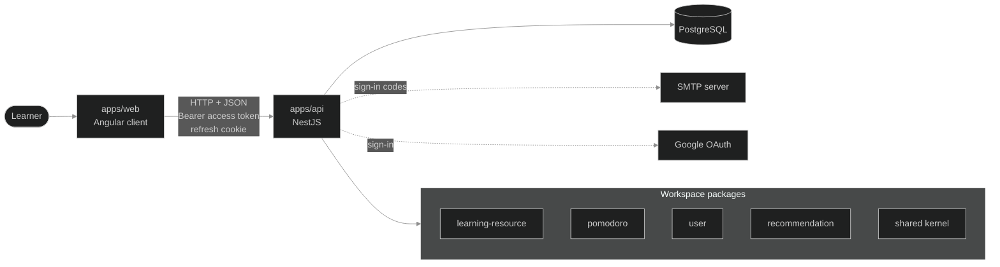

# Architecture

A map of how EAP is put together today: what each part is, where it lives
and what it may depend on. It doesn't explain how a particular flow works
inside. Those flows are the [mechanisms](#mechanisms), each with a document
of its own, and the reasoning behind every choice is in the
[decision record](#decision-record).

## Overview

The product ships as **Cauce**. EAP is the technical name used for the
repository, workspace packages, database and code identifiers, and
throughout this document (see ADR-0028).

EAP is a personal learning ecosystem made of two applications and a set of
packages, one group per business area:

- `apps/api` — a NestJS REST API backed by PostgreSQL through TypeORM.
- `apps/web` — an Angular client that talks to the API over HTTP.
- `learning-resource/`, `pomodoro/`, `user/`, `recommendation/` — the
  business logic, each split into `domain`, `application` and
  `infrastructure` packages.
- `shared/domain-lib` and `shared/infrastructure-lib` — the shared kernel
  every area builds on.

## System at a glance

The API is the only process with state. The web client keeps the access
token in memory and the refresh token in an `httpOnly` cookie scoped to
`/api/v1/auth`.

## Repository layout

A Yarn workspaces monorepo (ADR-0001), ESM throughout (ADR-0006).

| Package                     | Layer                     | May depend on                                           |
| --------------------------- | ------------------------- | ------------------------------------------------------- |
| `shared/domain-lib`         | Shared kernel             | Nothing internal                                        |
| `shared/infrastructure-lib` | Shared adapters           | `domain-lib`                                            |
| `<area>/domain`             | Domain                    | `domain-lib`                                            |
| `<area>/application`        | Application               | Its own `domain`, `domain-lib`                          |
| `<area>/infrastructure`     | Infrastructure            | Its own `domain` and `application`, the shared packages |
| `apps/api`                  | Composition root and HTTP | Every package                                           |
| `apps/web`                  | Client                    | Type-only imports of the error types (ADR-0030)         |

No area's package depends on another area's package. How areas still read
each other's data is described in [Across modules](#across-modules).

## Modules

| Module              | What it owns                                                                  | Key entities                                                                                             | ADRs                   |
| ------------------- | ----------------------------------------------------------------------------- | -------------------------------------------------------------------------------------------------------- | ---------------------- |
| `learning-resource` | The learner's library, topics, learning paths and the links between resources | `LearningResource`, `ResourceType`, `Topic`, `LearningPath` with its nodes and edges, `ResourceRelation` | 0011, 0016, 0021, 0029 |
| `pomodoro`          | Focus sessions, their segments and breaks                                     | `Session`, `Segment`, `Break`                                                                            | 0022, 0023, 0024, 0025 |
| `user`              | Accounts, sign-in, sessions, preferences and capabilities                     | `User`, `Identity`, `Session`, `SignInChallenge`, the capability catalog                                 | 0010, 0015, 0020       |
| `recommendation`    | What to study next, from the learner's calibration                            | `RecommendationContext`                                                                                  | 0027                   |

Learning paths live inside `learning-resource`, not in a package of their
own; the API exposes them through a separate `learning-path` module.

## Layering rules

Each module follows the same layers (ADR-0002). Dependencies point inward
only: infrastructure and the API depend on the application, the
application on the domain, and the domain on nothing but the shared kernel.

- **Domain** holds entities, value rules, errors and the ports
  (repository and service interfaces) the module needs. No framework code.
- **Application** holds use cases. A use case is a function that receives
  its dependencies as an object and its input as a request, and returns
  either a result or an error (ADR-0004). Errors are values, not
  exceptions, so every failure a caller can see is in the function's type.
- **Infrastructure** implements the domain's ports: TypeORM entities and
  repositories, and services such as crypto or email.
- **`apps/api`** is the composition root. NestJS modules wire concrete
  adapters into use cases, controllers validate input, call the use case,
  and map a returned error to an HTTP response. The signed-in learner is
  injected as `CurrentUser` rather than read from the request (ADR-0026).
- Validation happens at more than one layer, each for its own reason
  (ADR-0003).

Tests follow the packages: Vitest in `domain`, `application` and
`infrastructure`, Jest with supertest in `apps/api`, and the Angular test
runner in `apps/web`. Specs build their data with factories rather than
inline literals.

## Across modules

When a module needs data another module owns, it declares a port for
exactly what it needs in its own domain, and `apps/api` provides an
adapter that reads the other module's tables. The consuming module never
imports the owning one.

| Consumer                     | Port                                      | Adapter in `apps/api`                                                                                                          | Reads                                                  |
| ---------------------------- | ----------------------------------------- | ------------------------------------------------------------------------------------------------------------------------------ | ------------------------------------------------------ |
| `pomodoro`                   | Candidate nodes for the suggestion engine | `pomodoro/typeorm-candidate-nodes-adapter.ts`                                                                                  | Learning path nodes                                    |
| `pomodoro`                   | Learning path membership                  | `pomodoro/typeorm-learning-path-membership-adapter.ts`                                                                         | Learning paths                                         |
| `recommendation`             | Candidate resources and path steps        | `recommendation/typeorm-learning-resource-candidates-adapter.ts`, `recommendation/typeorm-learning-path-candidates-adapter.ts` | Resources and learning paths                           |
| `recommendation`, `pomodoro` | Whether the learner may get path steps    | `entitlements/path-steps-capability-adapter.ts`                                                                                | The learner's resolved capabilities                    |
| `user`                       | Account statistics                        | `user/typeorm-account-stats-adapter.ts`                                                                                        | Resources, learning paths and completed focus sessions |

The trade-off is that an adapter knows another module's tables. In
exchange, each module can be built and tested on its own, and every
cross-module read is listed in one place: the API's adapters.

## Web client

`apps/web` is Angular with standalone components and signals.

- `core/` — the app shell: guards, interceptors, layout, toasts, dialogs,
  error handling and API configuration.
- `shared/` — feature-agnostic components, UI primitives, pipes and
  utilities.
- `features/` — one folder per product area (`auth`, `learning-resource`,
  `learning-path`, `pomodoro`, `recommendation`, `settings`), each with its
  own `domain`, `application` and `infrastructure`, and a `presentation`
  folder when it has screens of its own.

It reaches the business logic only through the API. The one exception is
error types: it imports the domain's error names and contexts as types
only, so a renamed error breaks the client's build instead of its runtime
(ADR-0030). Loading, error and empty states follow one shared shape
(ADR-0032), and the visual language lives in `src/styles.css`.

## Mechanisms

A mechanism is a flow that crosses several of the parts above. Each one
gets a document in `docs/architecture/` with how it works today and an
append-only history of how it got there. The column fills in as each
document is written.

| Mechanism                       | Document                                                 | ADRs             |
| ------------------------------- | -------------------------------------------------------- | ---------------- |
| Authentication and sessions     | [authentication.md](docs/architecture/authentication.md) | 0010, 0020, 0026 |
| Capabilities and entitlements   | [capabilities.md](docs/architecture/capabilities.md)     | 0015             |
| API error contract              | [error-contract.md](docs/architecture/error-contract.md) | 0030             |
| Rate limiting                   | [rate-limiting.md](docs/architecture/rate-limiting.md)   | —                |
| Pomodoro session lifecycle      | —                                                        | 0022, 0024       |
| Recommendation engine           | —                                                        | 0027             |
| Loading, error and empty states | —                                                        | 0032             |

## Decision record

Every architectural decision is an ADR in [`docs/adr/`](docs/adr/). A
decision that changes later is revised inside its own ADR as a dated
revision, so the ADR keeps both the old reasoning and the new.
