# ADR-0020: Authentication Architecture

## Status

Accepted

## Context

EAP-Ecosystem reached v0.7.5 with a fully functional learning resource layer
but no real authentication. The existing `User` entity was designed around
a username/password model (`hashedPassword`, `emailValidationToken`,
`tokenConfirmedAt`, `tokenExpiresAt`) that was never wired to a running
auth flow — it existed only as domain scaffolding.

Before implementing authentication (v0.8.x), the architecture decisions
had to be made as a group, balancing security, simplicity for a personal
tool, and extensibility toward multi-provider support (Google, GitHub, MFA).

Several design questions were open:

- **How should sign-up vs. sign-in be handled?** A separate registration
  form adds friction and reveals whether an email is already registered.
- **How should multiple providers be supported?** Storing provider identity
  directly on `User` creates coupling and makes account linking complex.
- **How should sessions be managed?** JWTs alone cannot be revoked;
  stateless tokens are a poor fit for a tool that may run on shared devices
  or require emergency session invalidation.
- **What auth methods make sense for a personal productivity tool?**
  Password authentication adds implementation cost and a credential
  management burden with minimal benefit when passwordless alternatives exist.

## Decisions

### 1. Magic Link as the primary auth method (unified sign-in = sign-up)

A single entry point handles both new and returning users. The UI presents
one step (enter email) and one step (enter 6-digit code). The backend never
reveals whether an email is registered — the resolution of "new vs. existing
user" happens silently inside `verifySignInCode`, after the code is validated.

This eliminates enumeration risk, removes the registration form entirely, and
aligns with the pattern used by Notion and Linear for low-friction onboarding.

**Endpoints:**
- `POST /auth/sign-in/request` — generates a `SignInChallenge`, hashes the
  code, invalidates any previous pending challenge for that email, and
  dispatches the code via `EmailService`.
- `POST /auth/sign-in/verify` — validates hash, expiry, and attempt count;
  creates `User` + `Identity` if the user is new; issues a JWT access token + opaque refresh token and persists
  `Session` regardless.

### 2. `Identity` entity separated from `User`

A `User` is an application-level person. An `Identity` is a verified link
between a `User` and an external or internal authentication provider
(`magic-link`, `google`, `GitHub`).

One user can have multiple identities. Account linking (e.g., sign in with
Google on an account originally created via Magic Link) resolves cleanly by
looking up the identity's provider + subject before falling back to email
matching.

This avoids polluting `User` with provider-specific fields and supports
future providers without schema changes to the core user entity.

### 3. Opaque refresh token stored in DB with rotation and reuse detection

Access tokens are short-lived JWTs (15 minutes). Refresh tokens are
cryptographically random opaque strings stored as a SHA-256 hash in a
`Session` entity. SHA-256 is used instead of bcrypt because refresh tokens
are high-entropy random values (not user-chosen passwords), so the
brute-force resistance of bcrypt is unnecessary — and its non-determinism
would prevent O(1) equality lookup by hash. On every refresh:

1. The incoming token is hashed with SHA-256 and looked up by equality.
2. A new token pair is issued.
3. The old `Session` is replaced (rotation).
4. If a refresh token is used after it has already been rotated (reuse
   detected), the entire family is revoked (`revoke-all` on the user's
   sessions).

This allows:
- Individual session revocation (logout from one device)
- Logout everywhere (revoke all sessions)
- Future device listing (`Session` stores `userAgent` and `createdAt`)

### 4. Drop of password-related fields from `User`

The fields `hashedPassword`, `emailValidationToken`, `tokenConfirmedAt`,
and `tokenExpiresAt` are removed from the `User` entity. No real users
existed at the time of this change, making it a clean breaking change with
no migration cost.

Password-based authentication is explicitly **out of scope** for this
project. The SMTP dependency for Magic Link in self-hosted contexts (see
ADR-0019) is the accepted trade-off.

### 5. `featureConfig` and `widgetConfig` on `User` from day one

The modular system (ADR-0015) requires per-user configuration of which
features and dashboard widgets are active. These are stored directly on the
`User` entity as typed arrays rather than separate tables, avoiding premature
normalization for a personal tool where users are few.

## Implementation Plan

| Version | Scope                                                         |
|---------|---------------------------------------------------------------|
| v0.8.0  | `User` entity refactor + domain contracts for new entities + Docker |
| v0.8.1  | Magic Link end-to-end (NestJS + Angular login page)          |
| v0.8.2  | OAuth Google (+ extensible provider pattern)                 |
| v0.8.3  | JWT guards, route protection, resources scoped to user        |

## Consequences

### Positive

- No password storage means no credential leak surface.
- Unified sign-in/sign-up flow removes user friction and enumeration risk.
- `Identity` separation makes account linking and future providers additive
  changes rather than breaking ones.
- Refresh token rotation with reuse detection provides session security
  comparable to OAuth-style token flows.
- `featureConfig`/`widgetConfig` on `User` avoids a join table for a single-
  user tool while keeping the domain model clean.

### Negative

- Magic Link requires SMTP — self-hosters must configure an email provider.
  Mitigated by documenting `.env.example` thoroughly (see ADR-0019).
- Stateful refresh tokens mean the database is involved on every token
  refresh. Acceptable given the personal-tool scale; not a concern until
  multi-tenant scaling.
- Dropping `registerUser` use case and all password-related code is a
  breaking change on the domain layer. Accepted because no production users
  exist.

## Rejected Alternatives

- **Password authentication**: Adds a credential storage and hashing
  obligation, a "forgot password" flow, and brute-force protection — all
  for a personal tool where a single user controls the instance.
- **Separate sign-up and sign-in endpoints**: Reveals email existence,
  adds UI complexity, and requires a separate confirmation step.
- **Storing provider identity directly on `User`**: Works for one provider
  but requires schema migration for each additional provider. `Identity`
  is the standard pattern (used by Auth0, Supabase, Lucia).
- **JWT-only sessions (no refresh token in DB)**: Cannot be revoked.
  Acceptable for public APIs; not acceptable for a personal workspace tool.

## Revision 2026-10-23 — Grace window for rotated refresh tokens

**Status of this revision:** Accepted

### What prompted this revision

On 2026-10-22, while checking the dashboard in a browser, reloading the
page shortly after navigating to it signed the learner out. The refresh
request that the page sends on load failed with
`INVALID_OR_EXPIRED_CODE_ERROR`, and the app redirected to sign-in. Normal
cold loads of the same page also showed two refresh requests instead of
one.

Tracing the failure led to the refresh flow on the server. A refresh
revokes the old session and creates its replacement unconditionally, with
no tolerance for the same token arriving twice: the reload had cancelled a
refresh whose rotation the server still completed, so the next load
presented a token that was already revoked. The same flow showed that two
refreshes with one token can both succeed and leave an unused session
behind. Comparing that behavior with this ADR showed that decision 3 asks
for something stricter still. Reuse detection is not implemented yet, but
as written it would answer the same reload by revoking every session the
learner has. The fix cannot land without first changing the decision it
would contradict, which is what this revision does.

```mermaid
%%{init: {'theme': 'dark'}}%%
sequenceDiagram
    participant B as Browser
    participant A as API
    participant D as Sessions

    rect rgb(30, 30, 30)
        Note over B: First load, cookie holds token A
        B->>A: POST /auth/refresh (token A)
        A->>D: Revoke session A, create session B
        Note over B: Page reloads before the response arrives
        A--xB: Response with token B is discarded
        Note over D: Session B is never used and stays active

        Note over B: Second load, cookie still holds token A
        B->>A: POST /auth/refresh (token A)
        A->>D: Look up session A
        D-->>A: Revoked
        A-->>B: 400 INVALID_OR_EXPIRED_CODE_ERROR
        Note over B: Redirected to sign-in
    end
```

### What the original decision assumed

Decision 3 made every refresh token single-use: a refresh revokes the old
session and issues a new one, and a token presented after it has been
rotated is treated as stolen, revoking every session the user has. It
assumed that the client always receives the response of a refresh it
started, and that one client never refreshes twice with the same token.

### Why it changed

Neither assumption holds in a browser. A page that reloads while a refresh
is in flight discards the response, `Set-Cookie` included, but the server
still completes the rotation. The next page load sends the token that was
just revoked, the refresh fails and the learner is sent to sign-in. The
replacement session the server created is never used and stays listed as
an active device until it expires. Several tabs restored at once share one
cookie, so they refresh in parallel with the same token: depending on
timing, both succeed and leave an extra session behind, or the later ones
fail and sign out. With reuse detection in place, each of these ordinary
situations would sign the learner out on every device.

### New decision

#### A rotated token stays usable for a short grace window

A session records when it was rotated and which session replaced it,
separately from when it was revoked. For a configurable grace window after
rotation, 30 seconds by default, presenting the old token again succeeds:
the response carries a new access token and the same replacement refresh
token issued by the original rotation. Every request inside the window
therefore converges on one replacement session, whether it comes from a
reloaded page or from another tab.

#### The replacement token is derived, not stored

Refresh tokens are stored only as SHA-256 hashes, so the server cannot read
back the replacement it issued. The replacement is instead derived from
the old token with an HMAC keyed by a server secret dedicated to it.
Deriving it again inside the grace window yields the same token, and its
hash is checked against the replacement session before it is returned.

#### Rotation is conditional

A refresh revokes the old session only if it is still active, in the same
statement that marks it rotated. When two refreshes race on one token,
exactly one performs the rotation and the other is served through the grace
window, so no extra session is created.

#### Revoked sessions get no grace

The grace window applies only to a session that was rotated. A session the
learner revoked, or one ended by signing out, fails immediately, as it does
today. Outside the window, a rotated token also fails, without revoking
anything else.

#### Reuse detection is deferred

Point 4 of decision 3, revoking the user's sessions when a rotated token is
reused, is deferred to the Advanced Auth & Profile pass on the post-MVP
roadmap. That pass is not scheduled; it happens when a real need triggers
it, such as several active users, and covers authentication as one
coherent piece of work. When reuse detection is taken up there, it applies
only to reuse outside the grace window, and the scope it revokes, the
session's chain or every session the user has, is decided then.

### Consequences of the revision

#### Positive

- Reloading the page or restoring several tabs no longer signs the
  learner out.
- Racing refreshes stop leaving unused sessions in the learner's device
  list.
- Rotation still shortens the life of a copied token: once the owner
  refreshes outside the window, the copy stops working.

#### Negative

- For the length of the window, a copied token is as good as the original.
  It can only obtain the replacement the owner also receives, never a
  separate session.
- The server holds one more secret. Anyone who obtains it can derive a
  replacement token from an old one.
- Without reuse detection, a token used by someone else before its owner
  goes unnoticed until the owner is signed out and signs in again.
- Sessions carry two more fields, which needs a migration.

### Alternatives rejected in this revision

- **Stop rotating refresh tokens.** Keeping one token per session for its
  whole lifetime, still stored and revocable, removes the race entirely.
  Rejected because a copied token would then work for the full lifetime
  of the session unless someone revoked it by hand.
- **Issue a fresh replacement on every use inside the window.** Simpler,
  since nothing has to be derived, but each retry adds another session,
  which is the problem this revision removes.
- **Keep the old token valid until the replacement is first used.** Covers
  a lost response with no time limit, but every retry with the old token
  has to replace a pending replacement, and concurrent responses can leave
  the browser holding one that was just discarded.
- **Fix it only in the client.** Sharing one in-flight refresh within a tab
  and coordinating tabs reduces duplicate refreshes, but a page that
  unloads loses the response no matter what the client does. The client
  changes are still worth making, on top of the grace window.

## Revision 2026-11-17 — Local access mode for the desktop app

**Status of this revision:** Proposed

### What prompted this revision

Version 1.0.0 ships Cauce first as a desktop app that carries the API and an
encrypted SQLite database (ADR-0018 revision 2026-11-16, ADR-0034). The
learners it is for are students who aren't technical, on their own Windows
computer, with no server, no account and no email involved. Every way in that
this ADR defines needs something the desktop app doesn't have: Magic Link
needs SMTP, and Google sign-in needs an OAuth client and a network round trip
for a learner who only wants to open a study app. The database also needs a
key that survives daily use without being typed, and a way back to the data
when Windows is reinstalled or the learner moves to a new computer.

### What the original decision assumed

That Cauce always runs as a server shared by several learners, so every
learner proves who they are with an email or a Google account, and the data
lives on that server, protected by whoever operates it.

### Why it changed

On the desktop there is one learner per installation, and the operating
system account already decides who uses the computer. The risks that matter
for the students this is for are, in order: losing their data when they
reinstall Windows, change computers or a disk fails; being locked out by
forgetting something; and a copied or stolen disk exposing their data.
Someone else using the same open operating system session, or the app left
open, matter less for this audience and this kind of data.

A PIN was considered. It protects against someone using the same operating
system account, which is not a priority here, and it adds the risk that
matters most: forgetting it. It is left out of v1.0.0 and can be added later
on top of this design without changing it.

### New decision

#### A desktop deployment mode

The API has a named desktop mode, chosen by the shell when it starts it. In
that mode:

- the Magic Link and Google providers are not built and their routes are not
  registered, so no process on the computer can request a sign-in code or
  create a second user; tests check that those routes answer 404;
- production defaults apply, with no `NODE_ENV` to set, and no `.env` file is
  read; the working directory is fixed by the shell;
- no `JWT_SECRET` is required, since the secrets come from the shell;
- there is no `trust proxy`, no CORS and no form-encoded body parser.

#### The desktop app has one local profile and no sign-in routes

On first launch the learner creates a local profile with a first name and an
optional last name, then goes through the onboarding intake. Creating the
profile, restoring a backup, testing the recovery key and generating a new
one go through the shell over the channel between the processes, never
through an HTTP route that works without a session.

The profile's identity uses a new provider, `local`, whose subject is the
user's own id. `User.email`, and `email` on the shared `Person`, become
optional, unique when present; account linking by email (decision 2) ignores
users without one. `lastName` becomes optional too.

#### The shell opens the session; no HTTP endpoint does

The API listens on a port the operating system assigns and reports it to the
shell over the channel between the processes, so the shell always talks to
its own API and never to whatever answered on a port it picked. The shell
also watches the API process and shows an error if it exits.

At each launch the shell asks the API for a session over that channel. The API returns a refresh token for the local profile,
and the shell places it as the refresh cookie (`httpOnly`, `SameSite=Strict`,
path `/api/v1/auth`) in the window's own cookie store before loading the app.
The app then calls `/auth/refresh` on load, as it does on a server, and gets
its access token in the response body. The previous launch's session is
revoked when the new one is issued, so sessions don't pile up in the device
list. The cookie is not marked `Secure`, since the app is served over plain
HTTP on `127.0.0.1`.

Cookies are not tied to a port, so a cookie for `127.0.0.1` would also be
sent to any other port on the computer. The window therefore blocks every
request to a loopback address other than its own API's port, and its content
security policy keeps images and other resources off loopback addresses, so
an image URL in a note or an imported resource can't carry the refresh
cookie to another program. The window's session lives only in memory: the
cookie is never written to disk, and API responses are sent with
`Cache-Control: no-store` so learner data doesn't land in the browser cache
unencrypted.

Requests whose `Host` header is not `127.0.0.1:<port>` are rejected, which
closes DNS rebinding from a website in the learner's browser. A process or
website that reaches the API without the cookie gets the same 401 as any
unauthenticated request. Only the health check and the static web client are
reachable without a session.

#### Keys and who holds them

The shell owns every secret. On first launch it generates the database key,
256 random bits, and keeps it protected by the operating system keystore
(DPAPI on Windows, Keychain on macOS, libsecret on Linux). The token signing
secrets and the grace window secret are derived from the database key with
HKDF and separate labels, so there is only one secret to keep and to recover.
None of them is passed through the environment or written unprotected. Key
files are written with a temporary file and a rename, readable only by the
operating system user.

The shell never generates a new database key when a database already exists,
counting its `-wal` and `-shm` files and the wrapped key file. Any failure to
get the key from the keystore (a lost or reset Windows profile, a corrupted
keystore, a failed decryption) leads to asking for the recovery key, never to
a crash or a new key.

The SQLite3 Multiple Ciphers cipher and the raw key format are fixed
explicitly rather than left to library defaults, so backups keep opening
across library versions.

On Linux, Electron's `basic_text` fallback is treated as no keystore. Without
a keystore the app asks for the recovery key at each launch and keeps the
database key only in memory.

#### The recovery key

During onboarding the app shows a recovery key: 12 words from a fixed English
word list, which avoids accent and spelling issues, with a checksum that
catches typing mistakes, carrying at least 128 random bits. Input is
normalized (case, extra spaces). The learner is asked to type back three of
the words before finishing onboarding. The app suggests keeping the key on
paper, or in an account other than the one that holds the backup folder, and
warns that a phone photo or an email to oneself often ends up in the same
cloud account as the backups. It also warns when the key is saved inside the
backup folder or another synced folder.

A wrapping key is derived with HKDF from the 128 bits the words encode, with
a random salt and its own label, and encrypts a copy of the database key with
an authenticated cipher. The wrapped key file starts with a format version
and the algorithm identifiers, and stores the salt and the nonce; its
associated data binds the format version and the profile id. The recovery
key's fingerprint is derived through HKDF with a separate label. Because the
recovery key is random and long, a slow, memory-hard derivation such as
Argon2id would add no real protection; it becomes necessary only for a
future PIN, whose wrapped copy must never go into backups.

While the app still opens, Settings can test the recovery key and generate a
new one without asking for the old one. A new recovery key is written with a
temporary file and a rename, and is followed at once by a new full backup.
Older backups keep the recovery key they were made with, and each backup
records the fingerprint of the recovery key it needs. Regenerating covers a
lost recovery key, and the screen says so: it does not protect against a
leaked one, which needs a new database key, a new backup, pruning the old
copies, and a word about the cloud's version history. That rekey flow is
planned after v1.0.0.

#### Backups

The learner chooses a backup folder during onboarding, and the app suggests
one synced to the cloud when it finds it (OneDrive, Google Drive).

- **Consistent copies:** the API writes each backup with SQLite's online
  backup, with the database key set explicitly on the destination, to a
  temporary file. Before renaming it into place it checks that the file
  header isn't plaintext SQLite, that the copy opens with the key and fails
  without it, and that `integrity_check` passes.
- **What a backup contains:** the encrypted database, the wrapped key file,
  and metadata: profile id, recovery key fingerprint, schema migration
  version and date.
- **When:** at most once a day while the app is open. A backup on close is a
  bonus, not something the design relies on, since Windows may not let the
  app finish when it shuts down.
- **Retention:** the last 7 daily, 4 weekly and 3 monthly copies, so a silent
  problem can't replace every good copy within a week.
- **Never someone else's:** the app only prunes backups with its own profile
  id.
- **Status:** Settings shows the date of the last verified backup, and the
  app warns when it is older than a few days.

#### Restoring

On first launch, if the app finds backups in the suggested folder, the first
step is to restore, not to create a profile. A fresh installation can also
restore from any folder the learner points to. A backup is treated as
untrusted input: the app checks the wrapped key file's authentication, the
profile id and the schema version before using it. The learner types the
recovery key; the app recovers the database key, stores it in the new
computer's keystore and opens the restored database.

A backup from an older version is migrated after restoring, with a copy of
the restored database kept first. A backup from a newer version than the app
is refused with a message to update Cauce. Before migrating on an app update,
the app also takes a backup; this closes that open question in ADR-0034.

#### What isn't supported

- Two computers using the same profile and the same backup folder: their
  copies diverge and sync tools create conflicting files. The supported way
  to move is to restore on the new computer and stop using the old one.
- Separate operating system users on one computer each have their own
  keystore, profile and backup folder; nothing is shared between them.

#### What stays exposed

- Anyone using the learner's open operating system session, and any program
  running as that user, can open the app or ask the keystore for the key.
- The keystore is only as strong as the operating system account: on a
  Windows account with no password, or with automatic sign-in, a copied disk
  can be decrypted. During onboarding the app warns when the account has no
  password and recommends device encryption (BitLocker or Windows device
  encryption).
- The installers are unsigned and the app has no automatic updates in
  v1.0.0, so a tampered installer can't be told apart and the bundled
  Chromium ages between releases. Electron's run-as-Node and debugging fuses
  are turned off, which narrows what another program can inject.
- Losing the recovery key and the keystore at the same time, with no new
  recovery key generated in between, loses the data. No one, Cauce included,
  can recover it.

### Consequences of the revision

#### Positive

- The app opens with nothing to type, every day.
- A reinstalled or new computer gets the learner's data back with a backup
  and the recovery key, and a backup in a synced folder survives a dead disk.
- Backups are verified and retained in steps, so one bad day doesn't erase
  the good copies.
- A copied disk or a backup in the cloud exposes nothing without the
  learner's operating system account or the recovery key.
- Nothing in the desktop app depends on SMTP or Google; the web client's
  fonts are bundled instead of loaded from a CDN.

#### Negative

- Learners must keep the recovery key, and many won't until they need it.
- `email` becomes optional on `User` and `Person`, and `lastName` on `User`,
  which touches the domain, both engines' migrations and every place that
  assumes an email.
- Backups, restore, recovery key testing and regeneration and the Linux
  fallback are new flows to build and test before v1.0.0.
- A shared operating system account gives full access to the app.

### Alternatives rejected in this revision

- **A mandatory PIN from first launch:** protects a shared operating system
  account, at the cost of typing it every day and of losing the data when
  both the PIN and the recovery key are forgotten.
- **An optional PIN:** deferred, not discarded. It can wrap the database key
  on top of the keystore later, for learners who ask for it.
- **The keystore alone, with no recovery key or backups:** the simplest, but
  reinstalling Windows or changing computers loses everything.
- **Magic Link or Google sign-in on the desktop:** needs SMTP or an OAuth
  client and a network round trip, for a single local learner, and leaves
  routes a local process could use to create users.
- **A local HTTP endpoint that signs in with a per-launch secret:** any
  process able to read that secret, or to reach the endpoint before the
  window does, gets a session; placing the cookie from the shell avoids the
  endpoint altogether.
- **A recovery key in Spanish words:** accents and spelling variants make
  typing it back error-prone.

## References

- ADR-0010: Auth integrated within user module
- ADR-0015: Modular application system (`featureConfig`, `widgetConfig`)
- ADR-0019: Self-hosting and Docker strategy (SMTP context)
- OWASP Authentication Cheat Sheet
- OWASP Session Management Cheat Sheet

Revision 2026-10-23 — the decisions and guidance the grace window draws on:

- ADR-0026: `CurrentUser` as an Injected Dependency — the access token the
  grace window still issues is what every guarded request is checked against
- RFC 9700: Best Current Practice for OAuth 2.0 Security, §4.14 Refresh
  Token Protection — refresh token rotation for public clients

Revision 2026-11-17 — local access mode for the desktop app:

- ADR-0018: Desktop client strategy (revision 2026-11-16, the app bundles the
  API and the database)
- ADR-0034: Database engine per deployment (encrypted SQLite on the desktop)
