# ADR-0020: Authentication Architecture

## Status

Accepted

## Context

EAP-Ecosystem reached v0.7.5 with a fully functional learning resource layer
but no real authentication. The existing `User` entity was designed around
a username/password model (`hashedPassword`, `emailValidationToken`,
`tokenConfirmedAt`, `tokenExpiresAt`) that was never wired to a running
auth flow — it existed only as domain scaffolding.

Before implementing authentication (v0.8.x), the architecture decisions
had to be made as a group, balancing security, simplicity for a personal
tool, and extensibility toward multi-provider support (Google, GitHub, MFA).

Several design questions were open:

- **How should sign-up vs. sign-in be handled?** A separate registration
  form adds friction and reveals whether an email is already registered.
- **How should multiple providers be supported?** Storing provider identity
  directly on `User` creates coupling and makes account linking complex.
- **How should sessions be managed?** JWTs alone cannot be revoked;
  stateless tokens are a poor fit for a tool that may run on shared devices
  or require emergency session invalidation.
- **What auth methods make sense for a personal productivity tool?**
  Password authentication adds implementation cost and a credential
  management burden with minimal benefit when passwordless alternatives exist.

## Decisions

### 1. Magic Link as the primary auth method (unified sign-in = sign-up)

A single entry point handles both new and returning users. The UI presents
one step (enter email) and one step (enter 6-digit code). The backend never
reveals whether an email is registered — the resolution of "new vs. existing
user" happens silently inside `verifySignInCode`, after the code is validated.

This eliminates enumeration risk, removes the registration form entirely, and
aligns with the pattern used by Notion and Linear for low-friction onboarding.

**Endpoints:**
- `POST /auth/sign-in/request` — generates a `SignInChallenge`, hashes the
  code, invalidates any previous pending challenge for that email, and
  dispatches the code via `EmailService`.
- `POST /auth/sign-in/verify` — validates hash, expiry, and attempt count;
  creates `User` + `Identity` if the user is new; issues a JWT access token + opaque refresh token and persists
  `Session` regardless.

### 2. `Identity` entity separated from `User`

A `User` is an application-level person. An `Identity` is a verified link
between a `User` and an external or internal authentication provider
(`magic-link`, `google`, `GitHub`).

One user can have multiple identities. Account linking (e.g., sign in with
Google on an account originally created via Magic Link) resolves cleanly by
looking up the identity's provider + subject before falling back to email
matching.

This avoids polluting `User` with provider-specific fields and supports
future providers without schema changes to the core user entity.

### 3. Opaque refresh token stored in DB with rotation and reuse detection

Access tokens are short-lived JWTs (15 minutes). Refresh tokens are
cryptographically random opaque strings stored as a SHA-256 hash in a
`Session` entity. SHA-256 is used instead of bcrypt because refresh tokens
are high-entropy random values (not user-chosen passwords), so the
brute-force resistance of bcrypt is unnecessary — and its non-determinism
would prevent O(1) equality lookup by hash. On every refresh:

1. The incoming token is hashed with SHA-256 and looked up by equality.
2. A new token pair is issued.
3. The old `Session` is replaced (rotation).
4. If a refresh token is used after it has already been rotated (reuse
   detected), the entire family is revoked (`revoke-all` on the user's
   sessions).

This allows:
- Individual session revocation (logout from one device)
- Logout everywhere (revoke all sessions)
- Future device listing (`Session` stores `userAgent` and `createdAt`)

### 4. Drop of password-related fields from `User`

The fields `hashedPassword`, `emailValidationToken`, `tokenConfirmedAt`,
and `tokenExpiresAt` are removed from the `User` entity. No real users
existed at the time of this change, making it a clean breaking change with
no migration cost.

Password-based authentication is explicitly **out of scope** for this
project. The SMTP dependency for Magic Link in self-hosted contexts (see
ADR-0019) is the accepted trade-off.

### 5. `featureConfig` and `widgetConfig` on `User` from day one

The modular system (ADR-0015) requires per-user configuration of which
features and dashboard widgets are active. These are stored directly on the
`User` entity as typed arrays rather than separate tables, avoiding premature
normalization for a personal tool where users are few.

## Implementation Plan

| Version | Scope                                                         |
|---------|---------------------------------------------------------------|
| v0.8.0  | `User` entity refactor + domain contracts for new entities + Docker |
| v0.8.1  | Magic Link end-to-end (NestJS + Angular login page)          |
| v0.8.2  | OAuth Google (+ extensible provider pattern)                 |
| v0.8.3  | JWT guards, route protection, resources scoped to user        |

## Consequences

### Positive

- No password storage means no credential leak surface.
- Unified sign-in/sign-up flow removes user friction and enumeration risk.
- `Identity` separation makes account linking and future providers additive
  changes rather than breaking ones.
- Refresh token rotation with reuse detection provides session security
  comparable to OAuth-style token flows.
- `featureConfig`/`widgetConfig` on `User` avoids a join table for a single-
  user tool while keeping the domain model clean.

### Negative

- Magic Link requires SMTP — self-hosters must configure an email provider.
  Mitigated by documenting `.env.example` thoroughly (see ADR-0019).
- Stateful refresh tokens mean the database is involved on every token
  refresh. Acceptable given the personal-tool scale; not a concern until
  multi-tenant scaling.
- Dropping `registerUser` use case and all password-related code is a
  breaking change on the domain layer. Accepted because no production users
  exist.

## Rejected Alternatives

- **Password authentication**: Adds a credential storage and hashing
  obligation, a "forgot password" flow, and brute-force protection — all
  for a personal tool where a single user controls the instance.
- **Separate sign-up and sign-in endpoints**: Reveals email existence,
  adds UI complexity, and requires a separate confirmation step.
- **Storing provider identity directly on `User`**: Works for one provider
  but requires schema migration for each additional provider. `Identity`
  is the standard pattern (used by Auth0, Supabase, Lucia).
- **JWT-only sessions (no refresh token in DB)**: Cannot be revoked.
  Acceptable for public APIs; not acceptable for a personal workspace tool.

## Revision 2026-10-23 — Grace window for rotated refresh tokens

**Status of this revision:** Accepted

### What prompted this revision

On 2026-10-22, while checking the dashboard in a browser, reloading the
page shortly after navigating to it signed the learner out. The refresh
request that the page sends on load failed with
`INVALID_OR_EXPIRED_CODE_ERROR`, and the app redirected to sign-in. Normal
cold loads of the same page also showed two refresh requests instead of
one.

Tracing the failure led to the refresh flow on the server. A refresh
revokes the old session and creates its replacement unconditionally, with
no tolerance for the same token arriving twice: the reload had cancelled a
refresh whose rotation the server still completed, so the next load
presented a token that was already revoked. The same flow showed that two
refreshes with one token can both succeed and leave an unused session
behind. Comparing that behavior with this ADR showed that decision 3 asks
for something stricter still. Reuse detection is not implemented yet, but
as written it would answer the same reload by revoking every session the
learner has. The fix cannot land without first changing the decision it
would contradict, which is what this revision does.

```mermaid
%%{init: {'theme': 'dark'}}%%
sequenceDiagram
    participant B as Browser
    participant A as API
    participant D as Sessions

    rect rgb(30, 30, 30)
        Note over B: First load, cookie holds token A
        B->>A: POST /auth/refresh (token A)
        A->>D: Revoke session A, create session B
        Note over B: Page reloads before the response arrives
        A--xB: Response with token B is discarded
        Note over D: Session B is never used and stays active

        Note over B: Second load, cookie still holds token A
        B->>A: POST /auth/refresh (token A)
        A->>D: Look up session A
        D-->>A: Revoked
        A-->>B: 400 INVALID_OR_EXPIRED_CODE_ERROR
        Note over B: Redirected to sign-in
    end
```

### What the original decision assumed

Decision 3 made every refresh token single-use: a refresh revokes the old
session and issues a new one, and a token presented after it has been
rotated is treated as stolen, revoking every session the user has. It
assumed that the client always receives the response of a refresh it
started, and that one client never refreshes twice with the same token.

### Why it changed

Neither assumption holds in a browser. A page that reloads while a refresh
is in flight discards the response, `Set-Cookie` included, but the server
still completes the rotation. The next page load sends the token that was
just revoked, the refresh fails and the learner is sent to sign-in. The
replacement session the server created is never used and stays listed as
an active device until it expires. Several tabs restored at once share one
cookie, so they refresh in parallel with the same token: depending on
timing, both succeed and leave an extra session behind, or the later ones
fail and sign out. With reuse detection in place, each of these ordinary
situations would sign the learner out on every device.

### New decision

#### A rotated token stays usable for a short grace window

A session records when it was rotated and which session replaced it,
separately from when it was revoked. For a configurable grace window after
rotation, 30 seconds by default, presenting the old token again succeeds:
the response carries a new access token and the same replacement refresh
token issued by the original rotation. Every request inside the window
therefore converges on one replacement session, whether it comes from a
reloaded page or from another tab.

#### The replacement token is derived, not stored

Refresh tokens are stored only as SHA-256 hashes, so the server cannot read
back the replacement it issued. The replacement is instead derived from
the old token with an HMAC keyed by a server secret dedicated to it.
Deriving it again inside the grace window yields the same token, and its
hash is checked against the replacement session before it is returned.

#### Rotation is conditional

A refresh revokes the old session only if it is still active, in the same
statement that marks it rotated. When two refreshes race on one token,
exactly one performs the rotation and the other is served through the grace
window, so no extra session is created.

#### Revoked sessions get no grace

The grace window applies only to a session that was rotated. A session the
learner revoked, or one ended by signing out, fails immediately, as it does
today. Outside the window, a rotated token also fails, without revoking
anything else.

#### Reuse detection is deferred

Point 4 of decision 3, revoking the user's sessions when a rotated token is
reused, is deferred to the Advanced Auth & Profile pass on the post-MVP
roadmap. That pass is not scheduled; it happens when a real need triggers
it, such as several active users, and covers authentication as one
coherent piece of work. When reuse detection is taken up there, it applies
only to reuse outside the grace window, and the scope it revokes, the
session's chain or every session the user has, is decided then.

### Consequences of the revision

#### Positive

- Reloading the page or restoring several tabs no longer signs the
  learner out.
- Racing refreshes stop leaving unused sessions in the learner's device
  list.
- Rotation still shortens the life of a copied token: once the owner
  refreshes outside the window, the copy stops working.

#### Negative

- For the length of the window, a copied token is as good as the original.
  It can only obtain the replacement the owner also receives, never a
  separate session.
- The server holds one more secret. Anyone who obtains it can derive a
  replacement token from an old one.
- Without reuse detection, a token used by someone else before its owner
  goes unnoticed until the owner is signed out and signs in again.
- Sessions carry two more fields, which needs a migration.

### Alternatives rejected in this revision

- **Stop rotating refresh tokens.** Keeping one token per session for its
  whole lifetime, still stored and revocable, removes the race entirely.
  Rejected because a copied token would then work for the full lifetime
  of the session unless someone revoked it by hand.
- **Issue a fresh replacement on every use inside the window.** Simpler,
  since nothing has to be derived, but each retry adds another session,
  which is the problem this revision removes.
- **Keep the old token valid until the replacement is first used.** Covers
  a lost response with no time limit, but every retry with the old token
  has to replace a pending replacement, and concurrent responses can leave
  the browser holding one that was just discarded.
- **Fix it only in the client.** Sharing one in-flight refresh within a tab
  and coordinating tabs reduces duplicate refreshes, but a page that
  unloads loses the response no matter what the client does. The client
  changes are still worth making, on top of the grace window.

## References

- ADR-0004: Functional use cases with explicit DI
- ADR-0010: Auth integrated within user module
- ADR-0015: Modular application system (`featureConfig`, `widgetConfig`)
- ADR-0019: Self-hosting and Docker strategy (SMTP context)
- OWASP Authentication Cheat Sheet
- OWASP Session Management Cheat Sheet
