# ADR-0033: Hosted Instance Deploy Topology

**Date:** 2026-10-24

## Status

Accepted

## Context

Cauce has only ever run on a developer's machine. v1.0.0 puts a hosted
instance on the internet at `cauce.study` (ADR-0028), so the first outside
learners can use it without running anything themselves.

ADR-0019 already settled how Cauce is packaged for self-hosting: two images,
one for the API and one for the web client, published to a container
registry on every release tag and run with a Compose file. It did not say
where the hosted instance itself runs, or how a release gets there. Both
images build from `main` since [#344], the web client calls the API on its own
origin under `/api/v1`, and production migrations have a compiled entry
point (`migration:run:prod`).

Four constraints shape the choice:

- **Same origin for the API.** The refresh cookie is `SameSite=Strict` and
  scoped to `/api/v1/auth` (ADR-0020). Serving the API under the web
  client's origin keeps that cookie working with no cross-site settings and
  no CORS preflight on every call.
- **Latency from where the learners are.** The first learners are in
  Argentina. Round-trip times measured from Buenos Aires were about 4 ms to
  a datacenter in the city, 34 ms to São Paulo, 144 ms to the US East coast
  and 239 ms to Germany. A cold dashboard load makes a refresh call followed
  by several API calls, so every extra round trip is felt.
- **A fixed, small budget.** The domain and a year of hosting are paid for
  up front, preferably in pesos, since card payments in dollars carry an
  extra tax perception.
- **One artifact for everyone.** If the hosted instance runs the same images
  and Compose file that self-hosters get, every release is exercised in
  production before anyone else runs it, and ADR-0019 stops being only a
  plan.

## Decision

### One virtual server in Argentina runs the self-hosted Compose file

The hosted instance is a single virtual server with 2 vCPU and 2 GB of
memory, rented from DonWeb, an Argentine provider with datacenters in the
country, billed in pesos with VAT included. It runs Docker with the same
Compose file ADR-0019 publishes for self-hosters, plus a reverse proxy in
front.

The provider is an operational choice, not an architectural one. Any server
that meets these criteria can replace it with no change to the images or the
Compose file:

- South America (Argentina or São Paulo), for latency.
- Full virtualization with root access, so Docker runs unmodified.
- At least 2 GB of memory. The server never builds images, so this only has
  to hold PostgreSQL, the API, the web client's static server and the proxy.
- A dedicated public IPv4 address and a firewall in front of the server.

### Releases are built in CI and pushed to the server

```mermaid
%%{init: {'theme': 'dark'}}%%
sequenceDiagram
  rect rgb(30, 30, 30)
    participant Dev as Release tag
    participant CI as CI workflow
    participant Reg as Container registry
    participant Srv as Server
    Dev->>CI: push vX.Y.Z
    CI->>CI: build API and web images
    CI->>Reg: push eap-api:X.Y.Z and eap-web:X.Y.Z
    CI->>Srv: SSH as the deploy user
    Srv->>Reg: compose pull
    Srv->>Srv: run migrations (one-off API container)
    Srv->>Srv: compose up -d
  end
```

1. Pushing a release tag runs a CI workflow that builds both images and
   publishes them to the container registry with that version, as ADR-0019
   describes.
2. The same workflow connects to the server over SSH as a dedicated deploy
   user that can only run the deploy, using a key stored as a CI secret.
3. On the server it pulls the new images, runs the production migrations in
   a one-off API container, and only if they succeed restarts the stack with
   the new version.

Rolling back means deploying the previous tag. Migrations are not reverted
on a rollback, so from v1.0.0 on a migration must leave the schema usable by
the previous release: add columns and tables first, and drop or rename them
only in a later release.

### One proxy hop in front of the API

A reverse proxy on the server terminates HTTPS with certificates it obtains
and renews automatically. It routes `/api/` straight to the API container
and everything else to the web container.

The API trusts exactly one proxy hop (`trust proxy` is `1`), and the per-IP
rate limits read the client address from that hop. Routing `/api/` through
the web container's nginx as well would make two hops, and every learner
would appear to the API as the proxy's address, sharing one rate limit. The
web container's own `/api/` location stays for setups that run it without a
proxy in front.

Only ports 80 and 443 (and SSH, for the deploy user and the owner) are open
to the internet. PostgreSQL is reachable only inside the Compose network.

### The app and the landing page live on separate hosts

The application is served at `app.cauce.study`. The marketing landing page
is a static site on its own host at `cauce.study`, so it can change on its
own schedule without touching the server. `CORS_ORIGIN` and the Google
redirect URI point at the `app.` origin.

### Backups leave the server every day

The provider's weekly server backup covers losing the machine, but a week of
learner data is too much to lose. A daily `pg_dump` of the database is
copied to object storage outside the provider, and a restore from it is
tried once before the first outside learner signs up.

## Consequences

### Positive

- The hosted instance and every self-hosted install run the same images and
  Compose file, so a broken release shows up in production first, where it
  is noticed and fixed.
- Learners in Argentina get single-digit to low-double-digit round trips.
- The cost is a fixed monthly amount in pesos, with no usage-based billing
  to watch.
- A release is a tag: building, migrating and restarting need no manual
  steps on the server.

### Negative

- Operating the server is the owner's job: operating system updates, SSH
  hardening, disk space and watching that backups keep landing. The v1.0.0
  security pass has to cover the server, not only the code.
- A single server is a single point of failure. A hardware failure means
  downtime until it is restored from a backup.
- CI holds a key that can reach production. It is limited to a deploy user,
  but leaking it lets someone deploy arbitrary images.
- The provider has no public API, so creating or resizing the server is a
  manual step in its control panel.

## Rejected Alternatives

- **A managed platform with a hosted database** (Render, Railway). Less to
  operate, but none of them has a South American region, so every request
  pays about 144 ms, and the deploy would no longer exercise the self-hosted
  Compose file. The one platform with a São Paulo region (Fly.io) starts at
  US$38 a month for its managed database, above the budget.
- **A cheaper server in Europe** (about €4 a month). The lowest price, at
  about 239 ms per round trip.
- **The server pulling new images on its own.** CI would never need access
  to the server, but migrations would no longer run as a step before the
  restart, and knowing which version is live would mean asking the server.
- **A self-hosted deploy panel on the server** (Coolify, Easypanel).
  Convenient deploys, logs and backups from a web page, but the panel needs
  about 4 GB of memory, is one more exposed surface to secure, and is a
  second deploy definition alongside the Compose file. It can still be added
  later on top of the same Compose file.
- **Building images on the server.** Compiling the web client needs more
  memory than the server has, and it would make the server's state depend on
  whatever was checked out there.
- **A free-tier cloud server.** Capacity in the free tier is not reliably
  available, and the free allocation has changed without notice.

## References

- ADR-0019 — Self-Hosting and Docker Strategy: the images, registry and
  Compose file this instance runs.
- ADR-0020 — Authentication Architecture: the `SameSite=Strict` refresh
  cookie that requires the API on the client's origin.
- ADR-0028 — Product Name and Technical Name: the `cauce.study` domain.
- `docs/architecture/rate-limiting.md` — the per-IP limits that depend on
  the API seeing one proxy hop.
- [#344] — builds both images from `main` and serves the API under the web
  client's `/api/` path.

[#344]: https://github.com/ThiagoDelgado-D/EAP-Ecosystem/pull/344
