# Authentication and sessions

How a learner gets in, stays in and gets out. There are no passwords: a
learner signs in with a one-time code sent by email or with Google, and is
kept signed in by a short-lived access token renewed from a long-lived,
rotating refresh token.

## How it works today

```mermaid
%%{init: {'theme': 'dark'}}%%
sequenceDiagram
  rect rgb(30, 30, 30)
  participant Web as Web client
  participant API as AuthController
  participant UC as Use cases
  participant DB as PostgreSQL
  Web->>API: POST /auth/request-sign-in { email }
  API->>UC: requestSignIn
  UC->>DB: save SignInChallenge (code hash, 10 min)
  UC-->>Web: 204, code sent by email
  Web->>API: POST /auth/verify-sign-in { email, code }
  API->>UC: verifySignIn
  UC->>DB: create the user on first sign-in, save Session (token hash, 30 days)
  API-->>Web: { accessToken, user } + Set-Cookie refreshToken
  Note over Web: access token in memory,<br/>sent as Bearer on every request
  Web->>API: POST /auth/refresh (cookie), on a cold load or after a 401
  API->>UC: refreshSession
  UC->>DB: rotate the session if still active
  API-->>Web: { accessToken, user } + Set-Cookie with the replacement
  end
```

### Signing in

1. **Magic Link code.** `requestSignIn`
   (`user/application/src/use-cases/auth/request-sign-in.ts`) generates a
   six-digit code, stores only its bcrypt hash in a `SignInChallenge` that
   expires in ten minutes, invalidates the email's earlier challenges and
   emails the code. An invalid email returns quietly, and repeated requests
   for one email back off (see [rate limiting](rate-limiting.md)).
2. **Verifying the code.** `verifySignIn` accepts the code for the email's
   active challenge, at most five wrong guesses, and consumes it. On a first
   sign-in it creates the `User` with every optional module on, a
   `magic-link` `Identity`, and sends a welcome email. Every failure answers
   the same `InvalidOrExpiredCodeError`, so the response never reveals
   whether an account exists.
3. **Google.** `GET /auth/google` sets a ten-minute `google_oauth_state`
   cookie and redirects to Google. The callback checks the state, and
   `handleGoogleOAuth` finds the learner by their Google identity, or by a
   verified email to link a new `google` identity to an existing account, or
   creates one. The API then redirects to the web client's `/auth/callback`,
   with the access token and the user in the URL fragment, and the refresh
   cookie set.

### Tokens and sessions

- **Access token**: a JWT whose `sub` is the learner's id, signed with
  `JWT_SECRET`, valid for `JWT_EXPIRES_IN` (15 minutes by default). The web
  client keeps it in memory only.
- **Refresh token**: 32 random bytes, sent as the `refreshToken` cookie
  (`httpOnly`, `sameSite: strict`, path `/api/v1/auth`, `secure` in
  production, 30 days). The server stores only its SHA-256 hash, in a
  `Session` row with the device's user agent and IP.
- **Refreshing.** `refreshSession`
  (`user/application/src/use-cases/auth/refresh-session.ts`) finds the
  session by hash and checks it hasn't expired and the learner is still
  enabled. An active session is rotated: in one transaction it is marked
  revoked and rotated, only if it was still active, and its replacement is
  inserted. The replacement token is the old token's HMAC under
  `REFRESH_TOKEN_SECRET`.
- **Grace window.** A rotated token presented again within
  `REFRESH_TOKEN_GRACE_SECONDS` (30 by default) returns a new access token
  and the same replacement, recomputed from the old token, as long as the
  replacement is still active. This is what keeps a reload that cancelled a
  refresh, or several tabs refreshing at once, from signing the learner out.
  A session the learner revoked gets no grace.

### Guarding requests

`JwtAuthGuard` (`apps/api/src/auth/jwt-auth.guard.ts`) verifies the Bearer
token and puts the learner's id on the request, or answers 401. Controllers
read it with `@CurrentUser()` or `@CurrentUserId()` and pass it to use cases
as an injected `CurrentUser`, never as a field of the request model
(ADR-0026). Every use case scopes its queries to that learner.

### Devices and signing out

- `GET /auth/sessions` lists the learner's active sessions, marking the
  current one.
- `DELETE /auth/sessions/:id` revokes one of them, after checking it belongs
  to the learner. `DELETE /auth/sessions` revokes every one except the
  current.
- `POST /auth/sign-out` revokes the current session and clears the cookie.

### In the web client

- `AuthStore` holds the user, the capabilities and the access token.
  `authInterceptor` adds the Bearer header to every request.
- `authGuard` protects the shell. With no token in memory, as on every cold
  load, it refreshes. A refresh that fails for a transient reason (network,
  429, 5xx) is retried twice before the learner is sent to sign-in with the
  error: after one and then two seconds, or, on a 429, after the
  `retryAfterSeconds` the API sends, up to five seconds.
- `tokenRefreshInterceptor` handles a 401: it retries with the current token
  if another refresh already renewed it, and otherwise refreshes and
  retries.
- `AuthHttpService.refresh()` keeps one refresh in flight, shared by the
  guard and the interceptor.
- The session is cleared only when the server rejects the refresh (400 or
  401), never on a transient failure.

### Invariants

- No password is ever stored or accepted (ADR-0020).
- Sign-in codes and refresh tokens are stored only as hashes.
- A refresh token rotates on every use. Of two refreshes racing on one
  token, exactly one rotates, and both end on the same replacement.
- An access token identifies the learner and nothing else. What they may use
  is resolved from their capabilities on each response.
- A use case never reads the learner's identity from caller-supplied input.

### Key files

| Where          | File                                                                                                                                     |
| -------------- | ---------------------------------------------------------------------------------------------------------------------------------------- |
| Entities       | `user/domain/src/entities/user.ts`, `identity.ts`, `session.ts`, `sign-in-challenge.ts`                                                  |
| Use cases      | `user/application/src/use-cases/auth/`, `user/application/src/use-cases/sessions/`                                                       |
| Persistence    | `user/infrastructure/src/repositories/typeorm-session-repository.ts`, `apps/api/src/database/migrations/`                                |
| Crypto and JWT | `shared/infrastructure-lib/src/services/crypto-service-impl.ts`, `shared/infrastructure-lib/src/services/jwt-service-impl.ts`            |
| HTTP           | `apps/api/src/user/auth.controller.ts`, `apps/api/src/auth/`                                                                             |
| Configuration  | `apps/api/src/config/environment.service.ts`, `apps/api/.env.example`                                                                    |
| Web client     | `features/auth/`, `core/guards/auth.guard.ts`, `core/interceptors/auth.interceptor.ts`, `core/interceptors/token-refresh.interceptor.ts` |

## Evolution

### 2026-04-28 — Magic Link sign-in

Authentication was built into the user module (ADR-0010) without passwords
(ADR-0020): the `User`, `Identity`, `Session` and `SignInChallenge` entities
([#67]), the NestJS wiring ([#68]), the JWT service ([#70]), the sign-in
screens ([#71]) and onboarding ([#72]).

### 2026-05-05 — Google sign-in

Google was added as a second provider, linking to an existing account by
verified email ([#74]).

### 2026-05-06 — Refresh, rotation and sign-out

The access token began renewing silently from a rotating refresh token,
sign-out started revoking the server-side session, and the route guard
became real ([#77]). Each refresh token was single-use with no tolerance for
being presented twice.

### 2026-08-30 — One guard resolves the learner

Four controllers verified the Bearer token with their own copy of the same
code. `JwtAuthGuard` and `@CurrentUserId()` replaced them ([#133]).

### 2026-09-24 — The learner as an injected dependency

A security audit found the learning resource library shared by every
account. Fixing it settled where identity lives in a use case: an injected
`CurrentUser`, not a field of the request (ADR-0026, [#231]), rolled out to
the other modules afterwards. Revoking a device session started checking
that it belongs to the learner ([#237]).

### 2026-10-09 — Sign-in limits and a name collision

Signing in broke when the user module registered Pomodoro's `SessionEntity`
next to its own, since Nest named both repositories after the class
([#308]). Code requests and verifications got rate limits per address and a
backoff per email ([#313], [#314]).

### 2026-10-13 — Errors that say what happened

Sign-in and onboarding began showing the error the API returned instead of a
generic one ([#325]), and a missing device session got its own error name,
apart from Pomodoro's ([#330]).

### 2026-10-23 — A grace window for rotated tokens

A reload right after navigating signed the learner out: the reload cancelled
a refresh whose rotation the server had already done. ADR-0020 was revised
to give a rotated token a grace window and defer reuse detection ([#369]).
The server derives the replacement with an HMAC and rotates only an active
session ([#370]). The web client keeps one refresh in flight and signs out
only on a rejected refresh ([#371]). ADR-0019 was revised so Google sign-in,
not passwords, is the way in without SMTP ([#372]).

## Known limits and deferred

- **Reuse detection is deferred.** A rotated token presented after the grace
  window is rejected, but the learner's other sessions aren't revoked. It
  belongs to the post-MVP "Advanced Auth & Profile" item on the wiki's
  Roadmap.
- **Tabs aren't coordinated.** Several tabs restored at once each refresh on
  their own; the grace window makes them converge on one session.
- **Google hands over the access token in the URL fragment** of
  `/auth/callback`, which the web client reads and then replaces in the
  history.
- **Google credentials are required outside development,** and without SMTP
  the sign-in page still offers a code that can't be sent (ADR-0019,
  2026-10-23 revision).
- **Rate limiting** of sign-in is its own mechanism, in
  [rate-limiting.md](rate-limiting.md).

## References

- ADR-0010: Integration of Authentication and Authorization within User
  Module
- ADR-0019: Self-Hosting and Docker Strategy, 2026-10-23 revision
- ADR-0020: Authentication Architecture, with its 2026-10-23 revision
- ADR-0026: `CurrentUser` as an Injected Dependency

[#67]: https://github.com/ThiagoDelgado-D/EAP-Ecosystem/pull/67
[#68]: https://github.com/ThiagoDelgado-D/EAP-Ecosystem/pull/68
[#70]: https://github.com/ThiagoDelgado-D/EAP-Ecosystem/pull/70
[#71]: https://github.com/ThiagoDelgado-D/EAP-Ecosystem/pull/71
[#72]: https://github.com/ThiagoDelgado-D/EAP-Ecosystem/pull/72
[#74]: https://github.com/ThiagoDelgado-D/EAP-Ecosystem/pull/74
[#77]: https://github.com/ThiagoDelgado-D/EAP-Ecosystem/pull/77
[#133]: https://github.com/ThiagoDelgado-D/EAP-Ecosystem/pull/133
[#231]: https://github.com/ThiagoDelgado-D/EAP-Ecosystem/pull/231
[#237]: https://github.com/ThiagoDelgado-D/EAP-Ecosystem/pull/237
[#308]: https://github.com/ThiagoDelgado-D/EAP-Ecosystem/pull/308
[#313]: https://github.com/ThiagoDelgado-D/EAP-Ecosystem/pull/313
[#314]: https://github.com/ThiagoDelgado-D/EAP-Ecosystem/pull/314
[#325]: https://github.com/ThiagoDelgado-D/EAP-Ecosystem/pull/325
[#330]: https://github.com/ThiagoDelgado-D/EAP-Ecosystem/pull/330
[#369]: https://github.com/ThiagoDelgado-D/EAP-Ecosystem/pull/369
[#370]: https://github.com/ThiagoDelgado-D/EAP-Ecosystem/pull/370
[#371]: https://github.com/ThiagoDelgado-D/EAP-Ecosystem/pull/371
[#372]: https://github.com/ThiagoDelgado-D/EAP-Ecosystem/pull/372
