# Capabilities and entitlements

Decides what each learner can use. Every feature that can be turned off,
granted by a plan or offered as a beta is a capability, and one resolved map
of capabilities tells both the API and the web client what to show and what
to allow.

## How it works today

```mermaid
%%{init: {'theme': 'dark'}}%%
sequenceDiagram
  rect rgb(30, 30, 30)
  participant Web as Web client
  participant API as PreferencesController
  participant UC as updateEnabledModules
  participant Ent as EntitlementsProvider
  participant Res as resolveCapabilities
  Web->>API: PATCH /preferences/modules { enabledModules }
  API->>UC: learner id, enabled modules
  UC->>UC: save enabledModules on the User
  UC->>Ent: grantedTo(learner)
  Ent-->>UC: granted capability keys
  UC->>Res: catalog, granted keys, preferences
  Res-->>UC: state and stage for every capability
  UC-->>API: enabledModules + capabilities
  API-->>Web: 200 { enabledModules, capabilities }
  Web->>Web: AuthStore.updateModulePreferences(...)
  Note over Web: guards, navigation, dashboard,<br/>palette and screens re-read isEnabled(key)
  end
```

1. **The catalog.** `CAPABILITY_CATALOG`
   (`user/domain/src/entities/capability-catalog.ts`) lists every
   capability. A capability has a key, an optional `parent`, the
   capabilities it `requires`, and a `stage` (`stable` or `beta`). The four
   modules are the top-level keys (`resource-library`, `learning-paths`,
   `pomodoro`, `recommendation`); their features hang under them, such as
   `pomodoro.breaks` or `recommendation.path-steps`. `beta-channel` is a
   capability too.
2. **Preferences.** The learner turns optional modules on and off, stored as
   `enabledModules` on the `User`. `resource-library` can't be turned off
   (`MODULE_CATALOG` in `module.ts`). During onboarding the learner can
   start from a short intake instead: what they're here for and how they
   like to study. `composeSetup` (`user/domain/src/services/compose-setup.ts`)
   turns the answers into enabled modules, a weekly goal and the answers
   behind each choice, which `POST /preferences/intake/preview` returns
   without saving anything. The web client's onboarding asks the two
   questions, shows that setup with each reason worded from the answers
   behind it (`reasonFor` in `intake-options.ts`), and lets the learner
   change the modules and the goal before confirming. Onboarding completion
   stores the confirmed setup with the answers as the
   `User`'s `intake`, or leaves `intake` empty when they skipped it. Later,
   Settings reads the stored answers from `GET /preferences/intake`, and
   `PUT /preferences/intake` applies a retaken intake: the answers, the
   modules and the weekly goal the learner confirmed, returned with the
   resolved capabilities. Settings shows the answers in Active modules and
   retakes the intake in a side panel (`features/settings/presentation/intake/`)
   that marks what the proposal would turn on or off and the goal it
   replaces, and changes nothing until the learner applies it.
3. **Entitlements.** `EntitlementsProvider.grantedTo(learnerId)` returns the
   keys the learner's plan grants. Its only adapter today,
   `ImplicitPlanEntitlementsProvider` (`user/infrastructure`), grants every
   key in the catalog to everyone, wired in `apps/api/src/entitlements/`.
4. **Resolution.** `resolveCapabilities`
   (`user/domain/src/services/resolve-capabilities.ts`) gives each key one
   of three states, checking in this order:
   - its parent isn't `enabled` → it takes the parent's state;
   - the plan doesn't grant it → `locked`;
   - a capability it requires (plus `beta-channel` for a beta one) isn't
     `enabled` → the worst of their states;
   - it's a module the learner turned off, or the beta channel they didn't
     join → `disabled`;
   - otherwise → `enabled`.

   `resolveLearnerCapabilities` (`user/application/src/utils/`) is the one
   entry point: it asks the provider and resolves against the learner's
   preferences.

5. **On the wire.** Every response that carries the learner also carries the
   resolved map, keyed by capability with `state` and `stage`: sign-in
   (`verifySignIn`, Google), `refresh`, onboarding completion, and
   `GET`/`PATCH /preferences/modules`.
6. **In the web client.** `AuthStore` keeps the map with the user, and
   `isEnabled(key)` is the single check. `capabilityGuard(key)`
   (`core/guards/capability.guard.ts`) protects routes, redirecting to the
   dashboard. Navigation, the dashboard, the command palette and each screen
   ask `isEnabled` for their own key. After a settings change,
   `PreferencesService` hands the new map to the store, so the UI updates
   without a reload.
7. **In the API.** Turning a module off is a preference, not a permission:
   its endpoints keep answering. The API only consults capabilities where a
   module would otherwise hand out another module's work, through
   `PathStepsCapabilityAdapter` (`apps/api/src/entitlements/`):
   recommendations and Pomodoro's suggestions leave out learning path steps
   unless `recommendation.path-steps` or `pomodoro.path-focus` respectively
   is enabled.

### Invariants

- Every key in the catalog is present in every resolved map. A key the
  catalog doesn't know resolves as `locked`.
- A child is never more available than its parent, and never more available
  than what it requires.
- `locked` outranks `disabled`, which outranks `enabled`. A capability the
  plan stops granting shows as locked, and the learner's stored preference
  is kept for when it's granted again.
- Turning a module off never deletes its data, and history that involved it
  stays truthful. A session already running when its module is turned off is
  allowed to finish.
- Screens decide visibility from capability keys only, never from
  `enabledModules` directly.

### Key files

| Where              | File                                                                                                                                                         |
| ------------------ | ------------------------------------------------------------------------------------------------------------------------------------------------------------ |
| Catalog and types  | `user/domain/src/entities/capability.ts`, `capability-catalog.ts`, `module.ts`                                                                               |
| Resolution         | `user/domain/src/services/resolve-capabilities.ts`, `user/application/src/utils/resolve-learner-capabilities.ts`                                             |
| Entitlements       | `user/domain/src/services/entitlements-provider.ts`, `user/infrastructure/src/services/implicit-plan-entitlements-provider.ts`, `apps/api/src/entitlements/` |
| Preferences API    | `user/application/src/use-cases/preferences/`, `apps/api/src/user/preferences.controller.ts`                                                                 |
| Intake             | `user/domain/src/entities/intake.ts`, `user/domain/src/services/compose-setup.ts`, `user/application/src/use-cases/auth/complete-onboarding.ts`, `use-cases/preferences/apply-intake.ts`, `features/auth/presentation/onboarding/`, `features/settings/presentation/intake/` |
| Server-side checks | `apps/api/src/entitlements/path-steps-capability-adapter.ts`                                                                                                 |
| Web client         | `features/auth/application/auth.store.ts`, `core/guards/capability.guard.ts`, `features/settings/application/preferences.service.ts`                         |

## Evolution

### 2026-06-23 — Navigation follows `featureConfig`

Learning Paths and the knowledge graph needed a way to stay out of the
navigation for learners who didn't use them. The web client started deriving
the navigation from a `featureConfig` list stored on the user, toggled from
Settings ([#98]).

### 2026-10-13 — Only modules that exist, and one check

By then nothing read `featureConfig` any more: navigation, routes, the
dashboard, the palette and the recommendation engine looked the same
whatever the learner picked. Its keys had drifted too, naming features that
were never built and missing modules that were. ADR-0015 was revised to keep
only the modules that exist and route every check through one place
([#326]).

### 2026-10-19 — `enabledModules` from a domain catalog

`featureConfig` was replaced by `enabledModules`, validated against a module
catalog in the domain, with a migration for existing learners ([#350]). The
web client moved onto it ([#351]).

### 2026-10-21 — The capability tree, entitlements and the beta channel

The product is meant to become a subscription, and a feature turned off and
a feature a plan doesn't include need to look different. ADR-0015 was
revised again: capabilities with parents, requirements and stages, three
states, an `EntitlementsProvider` port and the beta channel as a capability
([#354]). The API began resolving capabilities and returning them with the
session and the module preferences ([#355]).

### 2026-10-22 — Every surface asks for its own key

The server stopped proposing path steps to learners who can't use them, in
recommendations ([#356]) and in Pomodoro's suggestions ([#357]). The web
client moved every surface onto `isEnabled`: the shared base ([#359]),
Learning Paths ([#360]), path focus in Pomodoro ([#361]), Pomodoro itself
([#362]), the dashboard's ways into it ([#364]), its breaks, weekly summary
and suggestion ([#365]), and Recommendations with calibration ([#366]).

### 2026-10-26 — Onboarding composes the first setup

Onboarding asked new learners to pick modules before they knew what each
one would do for them. The API gained the intake from ADR-0015's
2026-10-13 revision: `composeSetup` turns what the learner is here for and
how they like to study into enabled modules and a weekly goal, with the
answers behind each choice, and onboarding stores the confirmed setup with
those answers ([#377]).

### 2026-10-26 — The intake can be retaken from Settings

What a learner came for changes, and the answers stored at onboarding had no
way back out. The preferences API gained reading those answers and applying
a retaken intake with the setup the learner confirms ([#378]).

### 2026-10-26 — New learners answer the intake

The web client still asked new learners to pick modules blind. Its
onboarding replaced that step with the intake: two questions, the setup
the API composes from them with each reason worded from the answers, and
the modules and goal the learner confirms ([#379]).

### 2026-10-26 — Settings retakes the intake

With the answers stored and an endpoint to apply new ones, Settings gained
the retake beside the module toggles: the current answers, and a side panel
that shows what a new proposal would change before the learner applies it
([#380]).

## Known limits and deferred

- **The beta channel can't be joined yet.** `resolveLearnerCapabilities`
  passes `joinedBetaChannel: false`, and there is no switch in Settings, so
  every beta capability resolves as `disabled`. No capability is `beta`
  today.
- **Nothing is ever `locked`** while the implicit plan grants everything, so
  the locked offer has never been shown to a learner.
- **Where the API enforces each capability once something can be locked**,
  limits within a capability, how beta access is restricted and what a
  retired beta does with its data are listed under ADR-0015's 2026-10-21
  revision, "Deferred".

## References

- ADR-0015: Modular Application System, with its revisions of 2026-10-13 and
  2026-10-21
- PRs [#98], [#326], [#350], [#351], [#354], [#355], [#356], [#357], [#359],
  [#360], [#361], [#362], [#364], [#365], [#366], [#377], [#378], [#379],
  [#380]

[#98]: https://github.com/ThiagoDelgado-D/EAP-Ecosystem/pull/98
[#326]: https://github.com/ThiagoDelgado-D/EAP-Ecosystem/pull/326
[#350]: https://github.com/ThiagoDelgado-D/EAP-Ecosystem/pull/350
[#351]: https://github.com/ThiagoDelgado-D/EAP-Ecosystem/pull/351
[#354]: https://github.com/ThiagoDelgado-D/EAP-Ecosystem/pull/354
[#355]: https://github.com/ThiagoDelgado-D/EAP-Ecosystem/pull/355
[#356]: https://github.com/ThiagoDelgado-D/EAP-Ecosystem/pull/356
[#357]: https://github.com/ThiagoDelgado-D/EAP-Ecosystem/pull/357
[#359]: https://github.com/ThiagoDelgado-D/EAP-Ecosystem/pull/359
[#360]: https://github.com/ThiagoDelgado-D/EAP-Ecosystem/pull/360
[#361]: https://github.com/ThiagoDelgado-D/EAP-Ecosystem/pull/361
[#362]: https://github.com/ThiagoDelgado-D/EAP-Ecosystem/pull/362
[#364]: https://github.com/ThiagoDelgado-D/EAP-Ecosystem/pull/364
[#365]: https://github.com/ThiagoDelgado-D/EAP-Ecosystem/pull/365
[#366]: https://github.com/ThiagoDelgado-D/EAP-Ecosystem/pull/366
[#377]: https://github.com/ThiagoDelgado-D/EAP-Ecosystem/pull/377
[#378]: https://github.com/ThiagoDelgado-D/EAP-Ecosystem/pull/378
[#379]: https://github.com/ThiagoDelgado-D/EAP-Ecosystem/pull/379
[#380]: https://github.com/ThiagoDelgado-D/EAP-Ecosystem/pull/380
