# API error contract

How a failure travels from a use case to the message a learner reads. Every error response has one shape, `{ error: NAME, ...context }`, the name comes from the domain, and the web client reads it by name with types it shares with the API.

## How it works today

```mermaid
%%{init: {'theme': 'dark'}}%%
sequenceDiagram
  rect rgb(30, 30, 30)
  participant UC as Use case
  participant Ctrl as Controller
  participant Filter as GlobalExceptionFilter
  participant Int as apiErrorInterceptor
  participant Screen as Screen
  UC-->>Ctrl: returns a BaseError (name, context)
  Ctrl->>Ctrl: toHttpException(error): status from httpStatusMap
  Ctrl-->>Filter: throws ApiErrorException
  Filter-->>Int: status + { error: NAME, ...context }
  Int->>Int: toApiError(response): ApiError(name, status, context)
  Int-->>Screen: rejects with the ApiError
  Screen->>Screen: messageFor(error), or branch on its name
  end
```

1. **Errors are values.** A use case returns a `BaseError`
   (`shared/domain-lib/src/errors/base-error.ts`) instead of throwing. Each error has a `name` such as `LEARNING_PATH_NOT_FOUND_ERROR` and an optional typed `context`, for example `{ retryAfterSeconds }` on `TooManyRequestsError`.
2. **Each module's error union is derived.** Every application package
   exports a use case map and `UseCaseErrors<Map>` extracts the union of
   errors its use cases can return, for example `UserDomainError`
   (`user/application/src/use-case-map.ts`). Adding an error to a use case
   adds it to the union with no list to maintain.
3. **Mapping to a status.** A controller that gets an error back calls
   `toHttpException` (`apps/api/src/errors/domain-error-mapper.ts`).
   `httpStatusMap` is a `Record` over every error name in every module's
   union, so an error without a status fails to compile. It throws an
   `ApiErrorException` carrying `toErrorBody(error)`.
4. **One writer for every response.** `GlobalExceptionFilter`
   (`apps/api/src/filters/http-exception-filter.ts`) is the only place that
   writes an error response. An `ApiErrorException` goes out as it is. The
   framework's 401 becomes `UNAUTHORIZED_ERROR`. Any other HTTP exception,
   such as an unknown route or a body too large, and any unexpected
   exception become `UNEXPECTED_ERROR`, the latter with a 500 and a log
   line. DTO validation goes through `toValidationException`, which answers
   `VALIDATION_ERROR` with the message of each invalid field. The per-IP
   rate limiter answers `TOO_MANY_REQUESTS_ERROR`.
5. **The web client shares the types.** `core/errors/app-domain-error.ts`
   imports every module's error union as types only, with no runtime code
   from the backend packages (ADR-0030). `ApiErrorName` is that union's
   names plus `NETWORK_ERROR`.
6. **Reading a failed response.** `apiErrorInterceptor`, the outermost
   interceptor, turns every `HttpErrorResponse` into an `ApiError(name,
status, context)`. A status of 0 becomes `NETWORK_ERROR`. A body without a known name becomes `UNEXPECTED_ERROR`,
   which covers a proxy's error page or an error added to a newer API than the tab loaded.
7. **Saying it to the learner.** `ERROR_MESSAGES`
   (`core/errors/error-messages.ts`) has a message for every name, as a
   string or a function of the context. `messageFor(error)` returns it,
   `messageOf(unknown)` falls back to the unexpected message, and
   `ErrorNotifier` shows it as a toast. A screen that needs to react to a
   particular error branches on `error.name`.

### Invariants

- Every error response has the shape `{ error: NAME, ...context }`, and
  nothing else writes one.
- Every name a use case can return has an HTTP status and a message in the
  web client. Missing either fails the build.
- The web client imports backend error types only, never values.
- Names are unique across modules. Two errors from different modules never
  share a name, even when they mean similar things.
- Test doubles in the web client reject with real `ApiError`s, not generic
  errors.

### Key files

| Where                    | File                                                                                                   |
| ------------------------ | ------------------------------------------------------------------------------------------------------ |
| Error base and body      | `shared/domain-lib/src/errors/base-error.ts`, `error-body.ts`, `use-case-errors.ts`, `generic-errors/` |
| Module unions            | `<module>/application/src/use-case-map.ts`                                                             |
| API mapping              | `apps/api/src/errors/domain-error-mapper.ts`, `api-error-exception.ts`, `validation-exception.ts`      |
| API writer               | `apps/api/src/filters/http-exception-filter.ts`                                                        |
| Web types                | `apps/web/src/app/core/errors/app-domain-error.ts`, `api-error.ts`                                     |
| Web reading and messages | `core/errors/api-error.interceptor.ts`, `error-messages.ts`, `error-notifier.service.ts`               |

## Evolution

### 2026-03-10 — An exhaustive map from errors to statuses

Use case errors needed HTTP statuses without a hand-kept list.
`UseCaseErrors` began deriving each module's union from its use cases, and
the mapper became a `Record` that fails to compile when a name has no
status ([#32](https://github.com/ThiagoDelgado-D/EAP-Ecosystem/pull/32)).
A global filter started turning anything unexpected into
`UnexpectedError` ([#35](https://github.com/ThiagoDelgado-D/EAP-Ecosystem/pull/35)).

### 2026-09-25 — Keeping the name

A security audit found the mapper answering with the error's context and
dropping its name, so clients couldn't tell errors apart. The body started
carrying `error: NAME`
([#237](https://github.com/ThiagoDelgado-D/EAP-Ecosystem/pull/237)).

### 2026-10-11 — One format, and types shared with the web client

The web client showed generic messages because it had nothing reliable to
read. ADR-0030 decided it would share the domain's error types, type-only
([#315](https://github.com/ThiagoDelgado-D/EAP-Ecosystem/pull/315)). Each
error's context got its own type and only the context reached clients
([#318](https://github.com/ThiagoDelgado-D/EAP-Ecosystem/pull/318)). The
API wrote errors in five shapes depending on where they were raised, and
the global filter became the only writer, with one shape for all of them
([#319](https://github.com/ThiagoDelgado-D/EAP-Ecosystem/pull/319)).

### 2026-10-12 — The web client reads every error by name

The web client imported the error types
([#323](https://github.com/ThiagoDelgado-D/EAP-Ecosystem/pull/323)) and
began reading every failed response as an `ApiError`, with a message for
each name ([#324](https://github.com/ThiagoDelgado-D/EAP-Ecosystem/pull/324)).

### 2026-10-13 — Every screen says what went wrong

Screen by screen, generic failures were replaced with the error the API
returned: sign-in and onboarding
([#325](https://github.com/ThiagoDelgado-D/EAP-Ecosystem/pull/325)), rate
limits in minutes ([#327](https://github.com/ThiagoDelgado-D/EAP-Ecosystem/pull/327)),
calibration ([#328](https://github.com/ThiagoDelgado-D/EAP-Ecosystem/pull/328)),
Settings ([#329](https://github.com/ThiagoDelgado-D/EAP-Ecosystem/pull/329)),
Learning Paths ([#331](https://github.com/ThiagoDelgado-D/EAP-Ecosystem/pull/331)),
Pomodoro ([#333](https://github.com/ThiagoDelgado-D/EAP-Ecosystem/pull/333)),
the library and recommendations
([#334](https://github.com/ThiagoDelgado-D/EAP-Ecosystem/pull/334)), the
resource page and edit form
([#335](https://github.com/ThiagoDelgado-D/EAP-Ecosystem/pull/335)) and
capture ([#336](https://github.com/ThiagoDelgado-D/EAP-Ecosystem/pull/336)).
Two modules turned out to share `SESSION_NOT_FOUND_ERROR`, and the
sign-in one was renamed
([#330](https://github.com/ThiagoDelgado-D/EAP-Ecosystem/pull/330)).

### 2026-10-16 — Test doubles fail like the API

The web client's test doubles began rejecting with the API's own errors
instead of generic ones, in Pomodoro
([#343](https://github.com/ThiagoDelgado-D/EAP-Ecosystem/pull/343)) and in
the library and Learning Paths
([#345](https://github.com/ThiagoDelgado-D/EAP-Ecosystem/pull/345)).

## Known limits and deferred

- **Names are unique by convention.** Nothing checks across modules that
  two errors don't share a name; the collision in
  [#330](https://github.com/ThiagoDelgado-D/EAP-Ecosystem/pull/330) was
  found by reading a wrong message.
- **Unexpected errors are only logged to the console**; there is no error
  tracking service.

## References

- ADR-0003: Defense-in-Depth Validation Strategy
- ADR-0004: Functional Use Cases with Explicit Dependency Injection
- ADR-0030: Web Client Shares the Domain's Error Types
