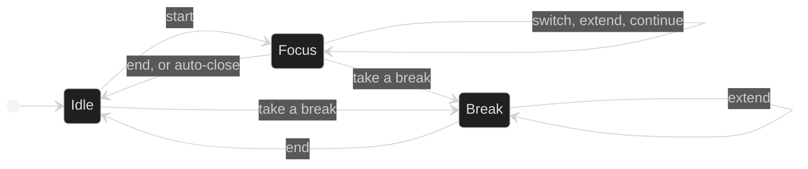

# Pomodoro session lifecycle

How a focus session and a break start, change and end. The server owns the
state: the web client asks it to start, switch, extend or end, and rebuilds
what's running from it after a reload. Time that was focused is recorded as
it happened, never more than the learner planned.

## How it works today

### What is stored

- A **`Session`** (`pomodoro/domain/src/entities/session.ts`) has a start, a
  planned length in minutes, an optional intent, and a `completedAt` once
  it's over. `autoCompleted` marks one the server closed by itself. A
  session without `completedAt` is the learner's active one; there is at
  most one.
- A session is split into **`Segment`s** (`segment.ts`), each covering a
  span of seconds from the session's start and focused on one target:
  `free`, a `resource`, or a learning path `node` (a node segment may have
  no resource yet, while its step is still a stub). Only the last segment is
  open.
- A **`Break`** (`break.ts`) has a start, a duration in seconds and an
  `endedAt` once it's over. There is at most one active break.

### Focus

1. **Start.** `startSession` refuses with `SESSION_ALREADY_ACTIVE_ERROR`
   when one is running, and otherwise saves the session and its first, open
   segment. The target is checked against what the learner owns
   (`resolveSegmentTarget`).
2. **Switch.** `switchTarget` closes the open segment at the current second
   and opens one on the new target. `attachOpenSegment` sets the target of
   the open segment instead, for a session started as free focus.
   `attributeSession` assigns a target to the segments of a session that has
   ended, after the fact.
3. **Extend.** `extendSession` adds minutes to the planned length of a
   running session, up to eight hours.
4. **End.** `endSession` closes through `closeSession` (`close-session.ts`):
   the session ends now or at its planned boundary, whichever comes first,
   so time past the plan never counts. A session shorter than a minute is
   deleted rather than kept. A completed one notifies through
   `NotificationPort` (ADR-0023).
5. **Continue.** Once the planned time has passed, `continueSession` closes
   the session at its boundary and opens the next one from that moment with
   the same intent and target. Before the boundary it answers
   `PLANNED_TIME_NOT_REACHED_ERROR`.
6. **Auto-close.** `getActiveSession`, which the web client calls to restore
   what's running, closes a session whose planned time has passed with no
   answer, at its boundary and marked `autoCompleted`, and reports it as
   auto-closed.

### Breaks

- `startBreak` refuses when a break is running, closes the active session
  through `closeSession` if there is one, and saves a five-minute break.
- `extendBreak` adds seconds, `endBreak` sets `endedAt`, and
  `getActiveBreak` returns the running one.

### Ownership

Every use case receives the learner as `CurrentUser`.
`verifySessionOwnership` and `verifyBreakOwnership` answer
`SESSION_FORBIDDEN_ERROR` or `BREAK_FORBIDDEN_ERROR` for another learner's
record, and a segment target must belong to the learner.

### In the web client

`PomodoroSessionStore`
(`features/pomodoro/application/pomodoro-session.store.ts`) mirrors the
server: phase (`idle`, `focus`, `break`), the active session, its segments
and the active break, with a one-second tick for the clock. Every action
goes to the API, and the store updates from the response. `rehydrate()`
restores the state after a reload, from any page, through
`GET /pomodoro/sessions/active` and then `/breaks/active`, keeping one
request in flight. A session the server auto-closed is shown as such instead
of resuming. The full, mini and zen views and the mini widget all read the
same store.

### Invariants

- At most one active session and one active break per learner.
- Recorded focus time never runs past the planned boundary, whether the
  session was ended, continued or auto-closed.
- A session under a minute leaves no record.
- Starting a break ends the focus session first.
- The server decides when something is over. The client never closes a
  session on its own timer.

### Key files

| Where              | File                                                                                         |
| ------------------ | -------------------------------------------------------------------------------------------- |
| Entities and ports | `pomodoro/domain/src/entities/`, `pomodoro/domain/src/` repositories and `NotificationPort`  |
| Use cases          | `pomodoro/application/src/use-cases/sessions/`                                               |
| Persistence        | `pomodoro/infrastructure/src/`                                                               |
| HTTP               | `apps/api/src/pomodoro/pomodoro.controller.ts`, `pomodoro.module.ts`                         |
| Web client         | `features/pomodoro/application/pomodoro-session.store.ts`, `features/pomodoro/presentation/` |

## Evolution

### 2026-09-07 — Sessions made of segments

A focus session was modeled as segments over targets, so switching material
mid-session keeps an honest record of where the time went (ADR-0022,
[#151]). Starting, switching, ending with a one-minute minimum and starting
a break followed ([#155], [#159], [#160], [#161]), with persistence and the
API ([#163], [#165]).

### 2026-09-11 — The web client and surviving a reload

The Start, Active and End screens shared one store ([#180], [#181], [#182],
[#189]). A reload lost the running session until the API exposed the active
one and the store restored it ([#183], [#184]).

### 2026-09-14 — Breaks on the server

Breaks lived only in the browser, so a reload lost them. Break became a
persisted entity with its own active query, extension and end
([#198]–[#203]), and the store moved onto it ([#204], [#205]).

### 2026-09-16 — Honest sessions

A session left running past its plan kept counting time nobody focused.
ADR-0022 was revised so a session closes at its planned boundary ([#211]):
the server auto-closes it and offers to continue ([#216]), the web client
asks at the boundary ([#217]), and ending past it no longer counts the extra
time ([#219]). Sessions could also be attributed after they ended ([#214]).

### 2026-09-20 — Extending in place

A running session could be extended without ending it ([#221], [#223]).

### 2026-09-25 — Ownership and time zones

A security audit found a learner could start a session on another learner's
path node; targets are now checked against the learner ([#235]), and the use
cases receive `CurrentUser` ([#233]). Session and break times moved to
`timestamptz` ([#236]).

### 2026-10-11 — The boundary prompt, tightened

The planned-time prompt stopped carrying into the next session ([#316]), and
continuing before the planned time began to be rejected ([#317]). A running
session started being restored after a reload on any page, not only on
Pomodoro's ([#322]).

### 2026-10-16 — A break ends the session

The rule that a break ends the focus session lived only in the client, as
two requests in an order that differed between screens. Once the server
rejected a break with a session still open, one screen broke and the other
could leave the learner with neither. ADR-0022 was revised so the server
ends the session when a break starts ([#340], [#341]), and the client
stopped doing it ([#342]).

## Known limits and deferred

- **A break never ends by itself.** It stays active past its duration until
  the learner ends it, so the widget can show a break from the day before at
  00:00.
- **A session is auto-closed only when something reads it.** Until the web
  client restores the state, a finished session still looks active in the
  database.
- **A break always starts at five minutes.** Configurable durations and
  cycle awareness are ADR-0024, which is post-MVP and not scheduled to a
  version.

## References

- ADR-0022: Pomodoro Focus Sessions, with its revisions
- ADR-0023: Notification Strategy (NotificationPort)
- ADR-0024: Pomodoro Settings & Cycle Awareness
- ADR-0025: Pomodoro Weekly Summary
- ADR-0026: `CurrentUser` as an Injected Dependency

[#151]: https://github.com/ThiagoDelgado-D/EAP-Ecosystem/pull/151
[#155]: https://github.com/ThiagoDelgado-D/EAP-Ecosystem/pull/155
[#159]: https://github.com/ThiagoDelgado-D/EAP-Ecosystem/pull/159
[#160]: https://github.com/ThiagoDelgado-D/EAP-Ecosystem/pull/160
[#161]: https://github.com/ThiagoDelgado-D/EAP-Ecosystem/pull/161
[#163]: https://github.com/ThiagoDelgado-D/EAP-Ecosystem/pull/163
[#165]: https://github.com/ThiagoDelgado-D/EAP-Ecosystem/pull/165
[#180]: https://github.com/ThiagoDelgado-D/EAP-Ecosystem/pull/180
[#181]: https://github.com/ThiagoDelgado-D/EAP-Ecosystem/pull/181
[#182]: https://github.com/ThiagoDelgado-D/EAP-Ecosystem/pull/182
[#183]: https://github.com/ThiagoDelgado-D/EAP-Ecosystem/pull/183
[#184]: https://github.com/ThiagoDelgado-D/EAP-Ecosystem/pull/184
[#189]: https://github.com/ThiagoDelgado-D/EAP-Ecosystem/pull/189
[#198]: https://github.com/ThiagoDelgado-D/EAP-Ecosystem/pull/198
[#203]: https://github.com/ThiagoDelgado-D/EAP-Ecosystem/pull/203
[#204]: https://github.com/ThiagoDelgado-D/EAP-Ecosystem/pull/204
[#205]: https://github.com/ThiagoDelgado-D/EAP-Ecosystem/pull/205
[#211]: https://github.com/ThiagoDelgado-D/EAP-Ecosystem/pull/211
[#214]: https://github.com/ThiagoDelgado-D/EAP-Ecosystem/pull/214
[#216]: https://github.com/ThiagoDelgado-D/EAP-Ecosystem/pull/216
[#217]: https://github.com/ThiagoDelgado-D/EAP-Ecosystem/pull/217
[#219]: https://github.com/ThiagoDelgado-D/EAP-Ecosystem/pull/219
[#221]: https://github.com/ThiagoDelgado-D/EAP-Ecosystem/pull/221
[#223]: https://github.com/ThiagoDelgado-D/EAP-Ecosystem/pull/223
[#233]: https://github.com/ThiagoDelgado-D/EAP-Ecosystem/pull/233
[#235]: https://github.com/ThiagoDelgado-D/EAP-Ecosystem/pull/235
[#236]: https://github.com/ThiagoDelgado-D/EAP-Ecosystem/pull/236
[#316]: https://github.com/ThiagoDelgado-D/EAP-Ecosystem/pull/316
[#317]: https://github.com/ThiagoDelgado-D/EAP-Ecosystem/pull/317
[#322]: https://github.com/ThiagoDelgado-D/EAP-Ecosystem/pull/322
[#340]: https://github.com/ThiagoDelgado-D/EAP-Ecosystem/pull/340
[#341]: https://github.com/ThiagoDelgado-D/EAP-Ecosystem/pull/341
[#342]: https://github.com/ThiagoDelgado-D/EAP-Ecosystem/pull/342
