# Rate limiting

Keeps the API from being used to flood an inbox, guess sign-in codes or make
the server fetch URLs on someone else's behalf. Two layers apply: a limit
per IP on every route, stricter where a request costs more than a database
read, and a backoff per email on requesting sign-in codes. Both answer 429
with the time to wait.

## How it works today

```mermaid
%%{init: {'theme': 'dark'}}%%
sequenceDiagram
  rect rgb(30, 30, 30)
  participant Web as Web client
  participant Guard as AppThrottlerGuard
  participant Ctrl as AuthController
  participant UC as requestSignIn
  participant DB as PostgreSQL
  Web->>Guard: POST /auth/request-sign-in
  alt over 3 requests from this IP in 10 min
    Guard-->>Web: 429 TOO_MANY_REQUESTS_ERROR, retryAfterSeconds + Retry-After
  else within the IP limit
    Guard->>Ctrl: pass
    Ctrl->>UC: requestSignIn(email)
    UC->>DB: this email's challenges from the last 24 h
    alt the backoff since the latest one hasn't passed
      UC-->>Ctrl: TooManyRequestsError(remaining seconds)
      Ctrl-->>Web: 429 + Retry-After
    else
      UC->>DB: new challenge, code emailed
      Ctrl-->>Web: 204
    end
  end
  end
```

1. **Per IP, on every route.** `RateLimitModule`
   (`apps/api/src/rate-limit/`) registers `@nestjs/throttler` with its
   in-memory storage and `AppThrottlerGuard` as a global guard. The default
   is 120 requests a minute per IP. `main.ts` sets `trust proxy` to 1, so
   the IP is the client's as seen by the first proxy, not the proxy's own.
2. **Stricter limits where a request costs more.** Routes override the
   default with `@Throttle`, using the values in `RATE_LIMITS`
   (`rate-limits.ts`):

   | Route                                                  | Limit per IP           |
   | ------------------------------------------------------ | ---------------------- |
   | `POST /auth/request-sign-in`                           | 3 every 10 minutes     |
   | `POST /auth/verify-sign-in`                            | 10 every 10 minutes    |
   | `POST /auth/refresh`, `GET /auth/google`, its callback | 20 a minute            |
   | `POST /learning-resources/preview`                     | 20 a minute            |
   | Every other route                                      | 120 a minute           |
   | `GET /health`                                          | none (`@SkipThrottle`) |

3. **The IP limit's answer.** When an IP is over its limit, the throttler
   sets `Retry-After` and `AppThrottlerGuard` answers with
   `TooManyRequestsError(timeToBlockExpire)`, so the body carries
   `retryAfterSeconds` in the same shape as every other error.
4. **Per email, on requesting a code.** An IP limit can't see which email is
   asked for, so rotating addresses could still fill one inbox, and each new
   code resets the five wrong guesses `verify-sign-in` allows.
   `requestSignIn` counts the email's challenges from the last 24 hours and
   requires a wait since the latest one that doubles with each request: one
   minute, two, four, up to an hour (`SIGN_IN_REQUEST_BACKOFF` in
   `user/domain/src/entities/sign-in-challenge.ts`). The rule lives in
   `assertRateLimit` and `exponentialBackoff`
   (`shared/domain-lib/src/utils/rate-limit.ts`). The count comes from
   challenges that already exist, since a replaced challenge is marked
   consumed rather than deleted, so no extra table is needed. The controller
   sets `Retry-After` from the error.
5. **In the web client.** Every 429 arrives as an `ApiError` named
   `TOO_MANY_REQUESTS_ERROR`, and its message says how long to wait in
   words, "Try again in 2 minutes" (`durationInWords`). On a cold load, the
   auth guard waits the `retryAfterSeconds` of a rate-limited refresh, up to
   five seconds, before retrying.

### Invariants

- A known and an unknown email are limited the same way, so a 429 never
  reveals whether an account exists.
- Every 429 has the same body, named `TOO_MANY_REQUESTS_ERROR` with
  `retryAfterSeconds`, and a `Retry-After` header.
- A limited request has no side effect: no code is generated, no pending
  code is invalidated and no email is sent.

### Key files

| Where             | File                                                                                                                  |
| ----------------- | --------------------------------------------------------------------------------------------------------------------- |
| Per-IP limits     | `apps/api/src/rate-limit/rate-limit.module.ts`, `app-throttler.guard.ts`, `rate-limits.ts`                            |
| Per-email backoff | `user/application/src/use-cases/auth/request-sign-in.ts`, `user/domain/src/entities/sign-in-challenge.ts`             |
| Backoff helpers   | `shared/domain-lib/src/utils/rate-limit.ts`, `shared/domain-lib/src/errors/generic-errors/too-many-requests-error.ts` |
| Proxy trust       | `apps/api/src/main.ts`                                                                                                |
| Web client        | `core/errors/error-messages.ts`, `shared/utils/duration-in-words.ts`, `core/guards/auth.guard.ts`                     |

## Evolution

### 2026-10-09 — A limit per IP

Nothing limited how often the API could be called. A script could keep
requesting sign-in codes, filling an inbox and the SMTP account's
reputation, and the URL preview made the server fetch any address it was
given. Every route got a per-IP limit, with stricter ones on sign-in and the
preview ([#313]).

### 2026-10-10 — A backoff per email

The per-IP limit couldn't stop requests that rotate addresses. Requesting a
code for one email started backing off exponentially, counted from its
recent challenges ([#314]).

### 2026-10-11 — The IP limit says how long to wait

The per-IP limit answered with a name but no wait, in a shape different from
other errors. With one error format for every response, it started returning
`retryAfterSeconds` like the per-email backoff ([#319]).

### 2026-10-13 — Waits in words

The web client began showing the wait the API sent ([#325]), and then said
it in minutes rather than raw seconds ([#327]).

### 2026-10-23 — The auth guard waits before retrying

A rate-limited refresh on a cold load used to sign the learner out. The
guard now retries it after the wait the API asks for, up to five seconds
([#371]).

## Known limits and deferred

- **Counts live in the API process's memory.** They reset when the API
  restarts and aren't shared between instances, which is enough for the
  single instance EAP runs today. More than one instance would need a shared
  store.
- **The per-email count resets with time, not with a successful sign-in.** A
  learner who signs in and right away asks for a code on a second device may
  wait a minute or two.
- **Only `request-sign-in` has a per-email limit.** Verifying relies on the
  per-challenge attempt limit and the per-IP limit.

## References

- ADR-0020: Authentication Architecture
- ADR-0030: Web Client Shares the Domain's Error Types

[#313]: https://github.com/ThiagoDelgado-D/EAP-Ecosystem/pull/313
[#314]: https://github.com/ThiagoDelgado-D/EAP-Ecosystem/pull/314
[#319]: https://github.com/ThiagoDelgado-D/EAP-Ecosystem/pull/319
[#325]: https://github.com/ThiagoDelgado-D/EAP-Ecosystem/pull/325
[#327]: https://github.com/ThiagoDelgado-D/EAP-Ecosystem/pull/327
[#371]: https://github.com/ThiagoDelgado-D/EAP-Ecosystem/pull/371
