# Recommendation engine

Picks what a learner should study next, from how they say they feel right
now. The learner's calibration (energy, mental state and time available) is
stored on the server, the candidates come from their library and active
learning paths, and a small set of signals ranks them, each with the reason
it gave.

## How it works today

```mermaid
%%{init: {'theme': 'dark'}}%%
sequenceDiagram
  rect rgb(30, 30, 30)
  participant Web as Dashboard
  participant API as RecommendationController
  participant UC as getRecommendations
  participant Ports as Candidate ports
  Web->>API: GET /recommendations?excludedCandidateIds=...
  API->>UC: learner, today's dismissals
  UC->>UC: load the learner's RecommendationContext
  UC->>Ports: resources, and path steps if allowed
  Ports-->>UC: candidates
  UC->>UC: merge, drop dismissed, score with every signal, sort
  UC-->>Web: [{ title, score, why[] }, ...]
  Web->>Web: top pick in Ideal Match
  end
```

1. **The calibration.** A `RecommendationContext`
   (`recommendation/domain/src/entities/recommendation-context.ts`) holds
   the learner's energy level (`low`, `medium`, `high`), an optional mental
   state (deep focus, light read, creative, quick op, review) and optional
   minutes available. `GET` and `POST /recommendations/context` read and
   save it. In the web client, `CalibrationService` loads it, creates it
   with defaults for a first-time learner, and saves changes from System
   Check and the header's mental-state picker.
2. **Candidates.** `getRecommendations`
   (`recommendation/application/src/use-cases/get-recommendations.ts`) asks
   two ports for candidates, both implemented in `apps/api` over the
   learning-resource tables: the learner's resources, and the next step of
   each active learning path. Path steps are only asked for when
   `allowsPathSteps` says the learner's capabilities allow them (see
   [capabilities](capabilities.md)).
3. **Merging.** `mergeCandidates` folds a path step into the resource it
   points to, so a resource that is also the next step of a path appears
   once, marked as such. A step without a resource yet stands on its own.
4. **Excluding.** The request can carry up to 100 ids the learner dismissed
   today, and candidates matching them by resource or node are dropped.
5. **Scoring.** `scoreRecommendations` (`recommendation-scorer.ts`) adds the
   points of every signal that applies, and collects each one's reason for
   the `why` list:

   | Signal                         | Points                       |
   | ------------------------------ | ---------------------------- |
   | Energy matches the calibration | +20; −10 at the opposite end |
   | Mental state matches           | +15                          |
   | Fits the minutes available     | +15; −10 over budget         |
   | Next step in an active path    | +25                          |
   | Not opened in 7 days or more   | down to −20 at 30 days       |

   Candidates are returned sorted by score.

6. **In the web client.** The dashboard's Ideal Match shows the top
   candidate with its reasons, and the next ones as second choices. "Focus
   now" opens Pomodoro's Start with the item attached. "Not today" is held
   by `RecommendationDismissalsService` in the browser's storage, per
   learner, until local midnight, and sent as `excludedCandidateIds`, so the
   list refills without it; it can be restored from the card.
7. **Pomodoro's suggestion.** Start's suggestion is a separate ranking in
   the Pomodoro module, but it receives the same calibration's energy and
   mental state from the web client, so both rankings follow what the
   learner said.

### Invariants

- The engine never writes anything: it reads the calibration and the
  candidates and returns a ranking.
- Every point a candidate gets comes with the reason the learner sees,
  except penalties, which lower the score silently unless they explain
  themselves (abandonment).
- Path steps are proposed only to a learner whose capabilities allow them.
- Without a saved calibration the engine answers
  `RECOMMENDATION_CONTEXT_NOT_FOUND_ERROR` rather than guessing one.

### Key files

| Where       | File                                                                                                                                                                                       |
| ----------- | ------------------------------------------------------------------------------------------------------------------------------------------------------------------------------------------ |
| Domain      | `recommendation/domain/src/entities/recommendation-context.ts`, `recommendation/domain/src/services/` (ports)                                                                              |
| Ranking     | `recommendation/application/src/use-cases/get-recommendations.ts`, `recommendation-scorer.ts`                                                                                              |
| Calibration | `recommendation/application/src/use-cases/get-recommendation-context.ts`, `set-recommendation-context.ts`                                                                                  |
| Adapters    | `apps/api/src/recommendation/typeorm-learning-resource-candidates-adapter.ts`, `typeorm-learning-path-candidates-adapter.ts`, `apps/api/src/entitlements/path-steps-capability-adapter.ts` |
| HTTP        | `apps/api/src/recommendation/recommendation.controller.ts`                                                                                                                                 |
| Web client  | `features/recommendation/application/recommendation.service.ts`, `calibration.service.ts`, `recommendation-dismissals.service.ts`                                                          |

## Evolution

### 2026-09-28 — An engine of its own

The recommendation module had sat scaffolded and empty. ADR-0027 settled a
persisted calibration per learner, reading other modules through ports, and
coexisting with Pomodoro's own suggestion rather than merging with it
([#240]). It was built as a domain with a persisted context ([#241]), the
ranking ([#242]), saving the calibration ([#243]) and the API with its
cross-module adapters ([#244]).

### 2026-09-30 — On the dashboard

The dashboard began showing the engine's pick ([#247]), with dismissing and
reranking in Ideal Match ([#250]).

### 2026-10-05 — One calibration across the app

The calibration was saved but never read back, so each screen started from
defaults. The API returned it ([#277]), and the web client shared it across
the app, with a mental-state picker in the header ([#278]).

### 2026-10-06 — Dismissals and the entry into focus

"Focus now" opened the resource's URL instead of starting a session, the
second choices had no action, and "Not today" was lost on reload. ADR-0022
and ADR-0027 were updated so the recommendation enters through Start and
dismissals are kept by the client ([#281]). The API began excluding
dismissed candidates ([#282]), "Focus now" and the second choices began
opening Start with the item attached ([#283]), and "Not today" was kept
until midnight with a way to restore it ([#285]). Pomodoro's suggestion
started ranking with the same calibration ([#286], [#287], [#288]).

### 2026-10-15 — Calibration failures

Loading or saving the calibration began saying what failed ([#328]), and a
failed load stopped overwriting the saved calibration with defaults
([#337]).

### 2026-10-22 — Following the learner's capabilities

The engine stopped proposing path steps to learners who can't use them
([#356]), and the dashboard and the header began showing Recommendations and
calibration only while their capabilities are on ([#366]).

## Known limits and deferred

- **The weights are fixed.** The points above are constants, not tuned from
  what learners choose.
- **"Not today" lives in one browser.** Dismissals are kept in local
  storage, so another device still shows a dismissed candidate, and
  dismissing the same item every day has no lasting effect.
- **History is barely used.** Besides when a resource was last opened, the
  ranking doesn't look at past focus sessions.

## References

- ADR-0027: Recommendation Engine
- ADR-0022: Pomodoro Focus Sessions
- [Capabilities and entitlements](capabilities.md)

[#240]: https://github.com/ThiagoDelgado-D/EAP-Ecosystem/pull/240
[#241]: https://github.com/ThiagoDelgado-D/EAP-Ecosystem/pull/241
[#242]: https://github.com/ThiagoDelgado-D/EAP-Ecosystem/pull/242
[#243]: https://github.com/ThiagoDelgado-D/EAP-Ecosystem/pull/243
[#244]: https://github.com/ThiagoDelgado-D/EAP-Ecosystem/pull/244
[#247]: https://github.com/ThiagoDelgado-D/EAP-Ecosystem/pull/247
[#250]: https://github.com/ThiagoDelgado-D/EAP-Ecosystem/pull/250
[#277]: https://github.com/ThiagoDelgado-D/EAP-Ecosystem/pull/277
[#278]: https://github.com/ThiagoDelgado-D/EAP-Ecosystem/pull/278
[#281]: https://github.com/ThiagoDelgado-D/EAP-Ecosystem/pull/281
[#282]: https://github.com/ThiagoDelgado-D/EAP-Ecosystem/pull/282
[#283]: https://github.com/ThiagoDelgado-D/EAP-Ecosystem/pull/283
[#285]: https://github.com/ThiagoDelgado-D/EAP-Ecosystem/pull/285
[#286]: https://github.com/ThiagoDelgado-D/EAP-Ecosystem/pull/286
[#287]: https://github.com/ThiagoDelgado-D/EAP-Ecosystem/pull/287
[#288]: https://github.com/ThiagoDelgado-D/EAP-Ecosystem/pull/288
[#328]: https://github.com/ThiagoDelgado-D/EAP-Ecosystem/pull/328
[#337]: https://github.com/ThiagoDelgado-D/EAP-Ecosystem/pull/337
[#356]: https://github.com/ThiagoDelgado-D/EAP-Ecosystem/pull/356
[#366]: https://github.com/ThiagoDelgado-D/EAP-Ecosystem/pull/366
